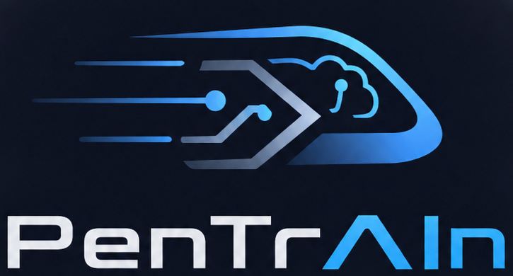

<p align="center">
  
</p>

# pentrAIn

**A self-hosted pentest training platform — quests, a live AI coach, and a browser-based Kali, on your own Proxmox.**

pentrAIn turns a Proxmox host into a guided offensive-security range:

- **Quest library** — topic tracks (Linux fundamentals, web appsec, Active Directory, network recon, forensics) with progressive tiers, from a single vulnerable VM to a full corporate network ([GOAD](https://github.com/Orange-Cyberdefense/GOAD)).
- **Browser workspace** — start a quest, get a real Kali desktop streamed into your browser (noVNC over Proxmox console), with the coach chat, objectives and flags beside it.
- **AI coach** — an agent watching your command stream live (silently — it never comments on commands), giving adaptive hints tuned to your experience level and answering questions with streamed Markdown/Mermaid replies. Four autonomy levels: `Spectate`, `Advisor`, `Copilot` (confirmed commands), `Takeover` (drives the Kali box in a visible terminal). Uses any OpenAI-compatible endpoint — recommended: a self-hosted abliterated model.
- **Defense-first** — every quest ships a `defense.md`: what you exploited, how to detect it, how to fix it.
- **Leaderboards** — per-quest scoring with hint/takeover penalties and time bonuses.
- **Clean reset** — snapshot rollback per quest, or full range rebuild.

## Architecture

```
Engine (Proxmox VE + Ludus)  ── either a dedicated PVE host or a nested engine VM on your homeserver
 ├── pentrain-app VM         frontend · backend · coach · sqlite · console-proxy (docker)
 ├── Session Kali VM         attack box w/ telemetry agent + qemu-guest-agent
 └── Quest VMs               targets behind the Ludus router (isolated /24, testing-mode)
```

[Ludus](https://ludus.cloud/) is used as an external range engine over its REST API — pentrAIn does not vendor or modify it.

## Install

Requires: a Proxmox VE host (dedicated to pentrAIn, or any PVE that can host one large nested VM), Ansible ≥ 2.15 on your admin machine.

```bash
cd installer
cp inventory.example.yml inventory.yml          # fill in your PVE host + API token
./install.sh --mode nested                      # or: --mode direct
```

- `nested` (default): creates a `pentrain-engine` VM (nested Proxmox + Ludus + app VM) on your existing homeserver. Leaves everything else untouched.
- `direct`: installs Ludus on the target PVE host itself. **The host must be dedicated to pentrAIn** — Ludus manages its users, networks and templates.

The installer shows a live status board (stage, running task, elapsed, counters) and writes a full log to `installer/logs/install.log`. Flags:

| Flag | Effect |
|---|---|
| `--with-templates` | build the Ludus VM templates (kali, debian, win2022) — multi-GB, multi-hour |
| `--i-know-dedicated` | direct mode only, required when the host already runs VMs/CTs |
| `--yes` / `-y` | skip the confirmation prompt |
| `--verbose` | raw ansible output instead of the status board |

After install, open `https://<pentrain-app-ip>` and run the setup wizard (LLM endpoint, resource budget).

## Repo layout

| Dir | What |
|---|---|
| `backend/` | FastAPI core: quests, sessions, flags, scoring, settings, WS hub, console proxy, telemetry ingest |
| `coach/` | Coach agent service (observer → state → policy → act) |
| `frontend/` | React 19 + Vite + TS + Tailwind v4 (custom component kit) |
| `content/` | Quest packs, `pentrain.*` Ansible roles, pack linter |
| `installer/` | Ansible: `--mode nested|direct` full bootstrap |
| `engine/` | App-VM docker-compose stack |
| `telemetry-agent/` | `pentrain-telemetried` — in-Kali command-stream sidecar |
| `cli/` | `pentrain` admin CLI (doctor, pack lint) |
| `docs/` | ADRs, [security posture](docs/SECURITY.md), [quest authoring](docs/quest-authoring.md), [ops runbook](docs/ops.md) |

## Development (no Proxmox needed)

```bash
docker compose -f engine/docker-compose.dev.yml up   # runs the stack on MockProvider
```

MockProvider simulates the full range lifecycle (deploy → ready → reset) plus canned telemetry, so the whole app — including the coach — is testable on a laptop.

## Security

Deliberately vulnerable VMs run here. Read [docs/SECURITY.md](docs/SECURITY.md) before exposing anything. Default posture: isolated ranges (Ludus testing mode), no public exposure, secrets server-side only.

## License

Apache-2.0 — see [LICENSE](LICENSE). Ludus (AGPL) is consumed as an external service via its API only.
