<p align="center">
  
</p>

<h1 align="center">pentrAIn</h1>

<p align="center">
  <strong>A self-hosted pentest training platform — quests, a live AI coach, and a browser-based Kali, on your own Proxmox.</strong>
</p>

<p align="center">
  <a href="#quickstart">Quickstart</a> ·
  <a href="docs/README.md">Documentation</a> ·
  <a href="docs/architecture.md">Architecture</a> ·
  <a href="docs/tracks.md">Quest catalog</a> ·
  <a href="docs/SECURITY.md">Security</a>
</p>

<p align="center">
  
  
  
  
  
</p>

---

pentrAIn turns a Proxmox host into a guided offensive-security range. Pick a
quest, get a fresh isolated lab — router, targets, and a real Kali desktop
streamed into your browser — with an AI coach watching your command stream
and adapting to how you work.

> [!IMPORTANT]
> **Active development — read before installing.**
>
> - **Requires a Proxmox host.** Either a fresh, dedicated machine
>   (`--mode direct`) or an existing PVE server (`--mode nested`, runs the
>   whole range inside one VM with nested virtualization).
> - **Not every quest runs on every host.** Quests are gated on the host's
>   live capacity — small hosts skip the RAM-hungry ones (Active Directory
>   needs the most; the unlock list always says why a quest is locked).
> - **Active Directory is untested** — the AD track and its Windows
>   templates have not been verified on a live range yet.
> - **No GPU integration yet** — the Kali worker is CPU-only for now.

<p align="center">
  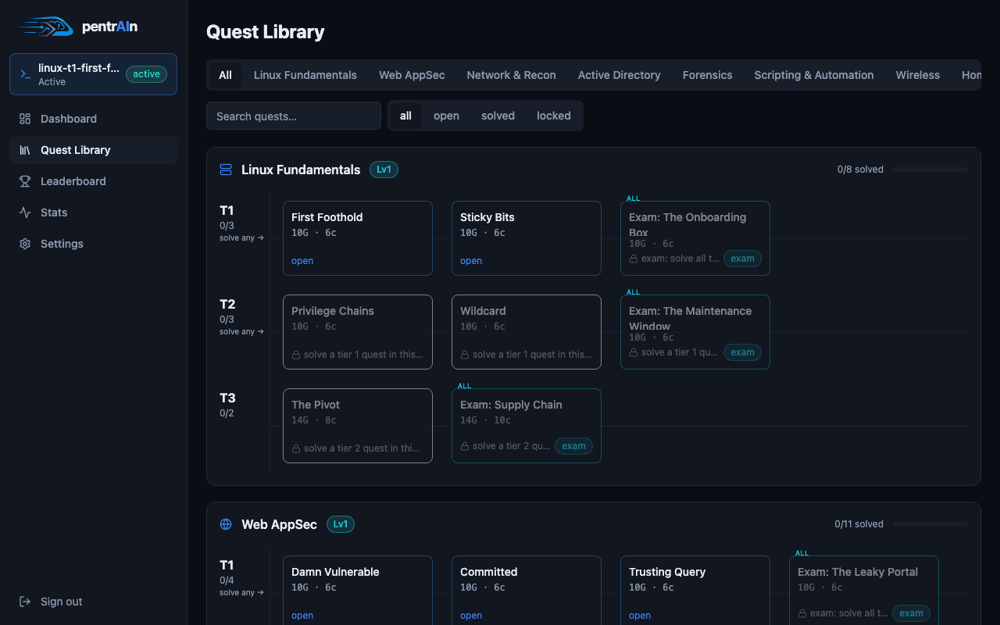
</p>

## Features

<table>
  <tr>
    <td width="50%">
      <h3>🗺️ Quest library</h3>
      <b>57 quests in 9 tracks</b> — Linux, web appsec, network recon, AD,
      forensics, scripting, wireless, home-lab, capstone. Tiered progression,
      exam capstones, staged hints that cost points.
    </td>
    <td width="50%">
      <h3>🖥️ Browser workspace</h3>
      A real <b>Kali desktop over noVNC</b>, objectives and flags on the
      left, coach on the right — resizable panels, notes, cheatsheets,
      network map, live stats.
    </td>
  </tr>
  <tr>
    <td>
      <h3>🤖 AI coach</h3>
      Watches your telemetry and answers with streamed Markdown. <b>Four
      autonomy levels</b> — Observer → Mentor → Copilot → Autonomous — from
      silent hints to driving your Kali in a visible tmux, including
      <b>parallel worker agents</b>.
    </td>
    <td>
      <h3>🎯 Dynamic flags</h3>
      <code>pentrAIn{...}</code> secrets are <b>HMAC-derived per session</b>
      and injected post-deploy via the QEMU guest agent — soft resets
      re-randomize them, walkthroughs can't be memorized.
    </td>
  </tr>
  <tr>
    <td>
      <h3>🛡️ Defense-first</h3>
      Every quest ships a <code>defense.md</code>: what you exploited, how
      to detect it, how to fix it — training for both sides of the wire.
    </td>
    <td>
      <h3>🏆 Scoring</h3>
      Per-quest leaderboards with time bonuses, hint costs, takeover
      penalties — and a <b>solve-style badge</b> recording how much help
      you took (<code>solo</code> is the flex).
    </td>
  </tr>
  <tr>
    <td>
      <h3>🌐 Kali uplink on demand</h3>
      One click hot-plugs a second NIC onto your LAN bridge — internet for
      <code>apt</code> and wordlists, while targets stay isolated.
    </td>
    <td>
      <h3>🧰 Guided Kali builder</h3>
      Clone a base template, customize it through the web console,
      finalize — every future session boots <b>your</b> Kali.
    </td>
  </tr>
</table>

## The coach, in one picture

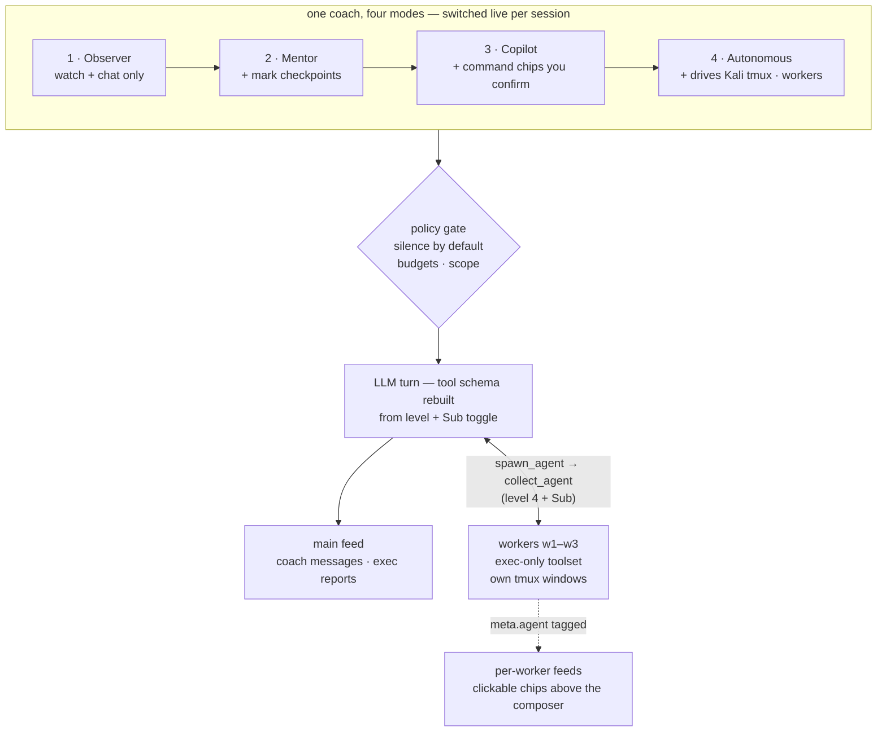

## Screenshots

<p align="center">
  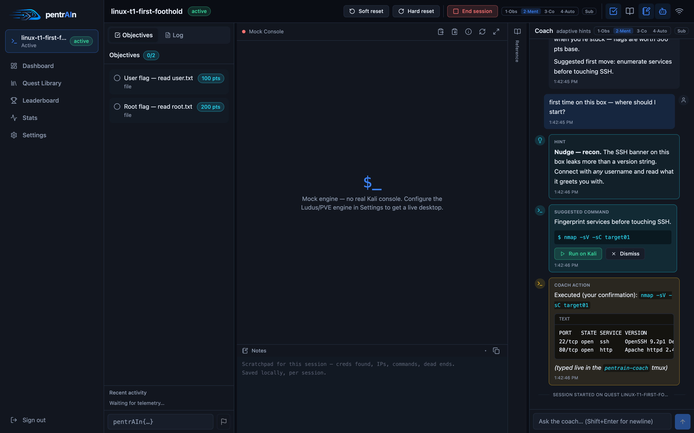
</p>

<p align="center">
  
  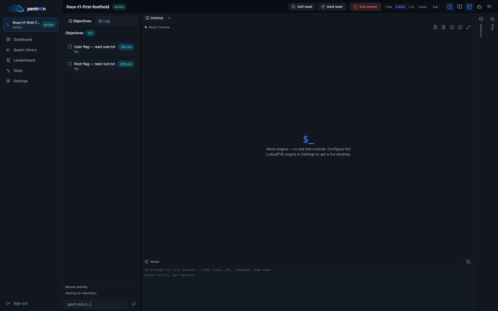
</p>

<p align="center">
  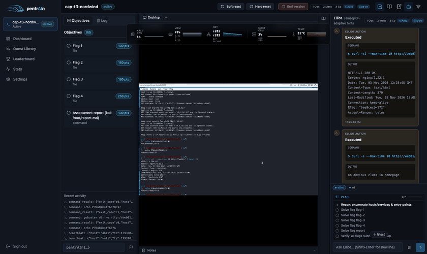
</p>

<details>
<summary><b>More screenshots</b></summary>
<br/>

| Dashboard | Library |
|---|---|
| 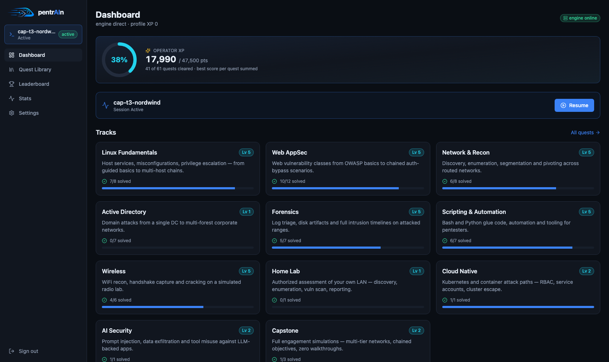 | 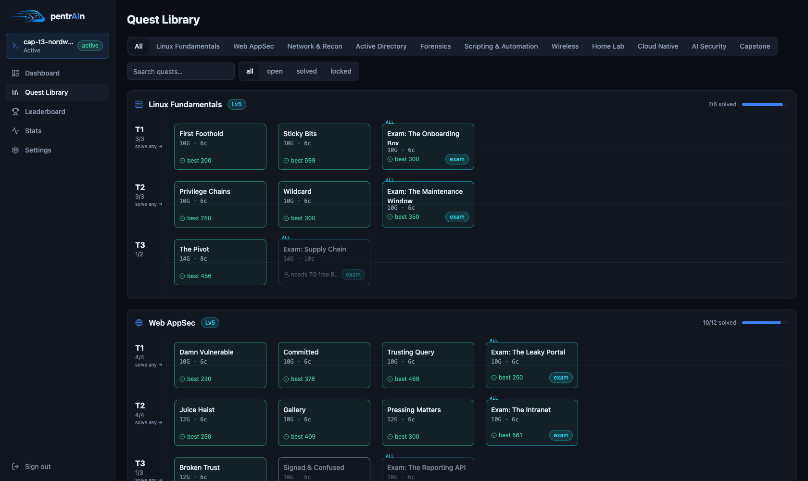 |

| Quest briefing | Settings |
|---|---|
| 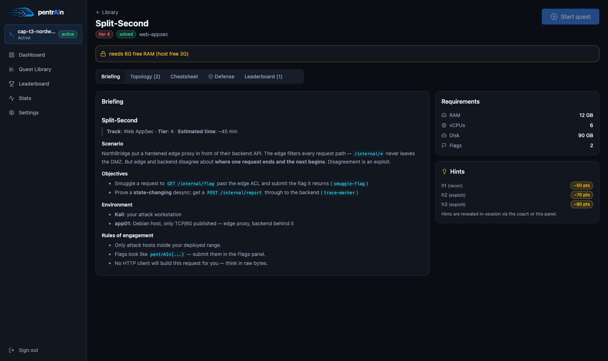 | 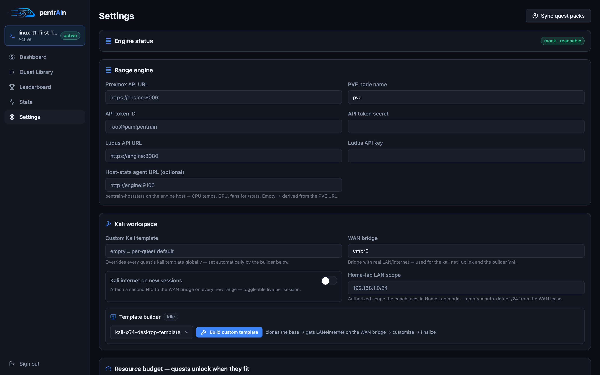 |

| Autonomous session | Panels tour |
|---|---|
| 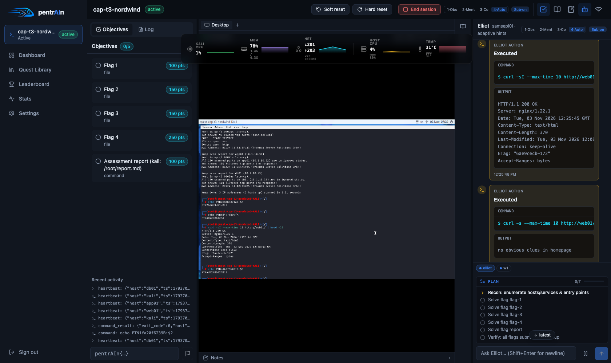 | 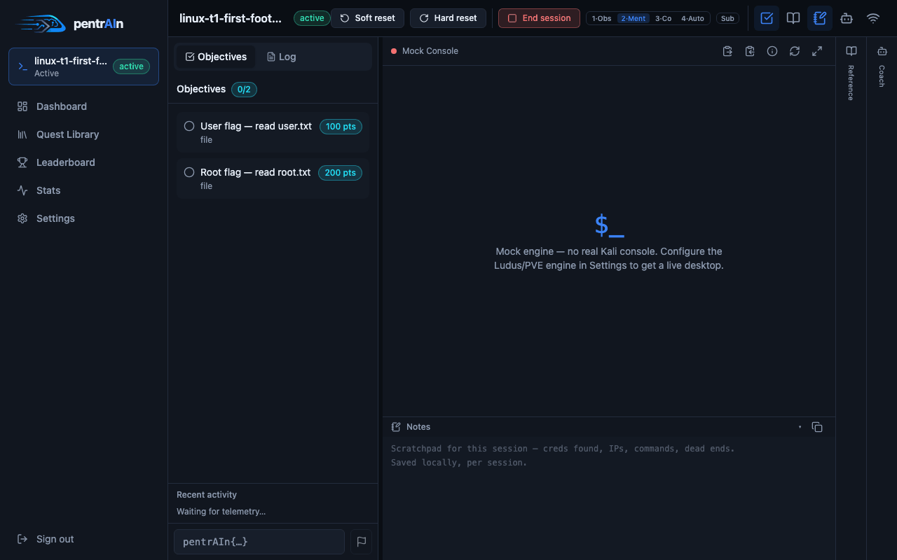 |

| Internet toggle | |
|---|---|
|  | |

</details>

## Architecture

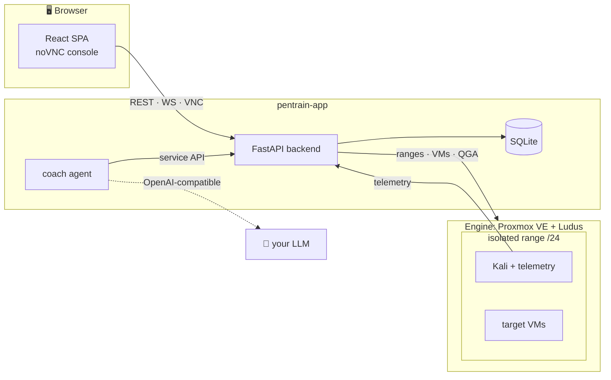

[Ludus](https://ludus.cloud/) is consumed as an **external range engine**
over its REST API — pentrAIn doesn't vendor or modify it. The coach talks to
any OpenAI-compatible endpoint; a self-hosted model keeps everything
on-prem.

Deep dive: [docs/architecture.md](docs/architecture.md) · decisions:
[docs/adr/](docs/adr/)

## Quickstart

Requires a Proxmox VE host (dedicated, or any PVE that can host one large
nested VM) and Ansible ≥ 2.15:

```bash
cd installer
cp inventory.example.yml inventory.yml   # your PVE host + API token
./install.sh --mode nested               # or: --mode direct
```

- **`nested`** (default): builds a `pentrain-engine` VM — nested Proxmox +
  Ludus + app VM — on your existing homeserver. Leaves everything else
  untouched.
- **`direct`**: installs Ludus on the target PVE host itself — the host must
  be **dedicated** to pentrAIn.

Then open `https://<pentrain-app-ip>`, walk the setup wizard, and start
*Linux Fundamentals → First Foothold*.

→ Full guide: [docs/getting-started.md](docs/getting-started.md)

## Development (no Proxmox needed)

```bash
make dev   # backend + coach + frontend against MockProvider
```

MockProvider simulates the full range lifecycle so the whole app — sessions,
flags, coach plumbing, leaderboards — is testable on a laptop.

→ [docs/development.md](docs/development.md)

## Documentation

| | |
|---|---|
| 🚀 [Getting started](docs/getting-started.md) | Install modes, setup wizard, first quest |
| 🖥️ [Workspace](docs/workspace.md) | Console, panels, flags, resets, Kali internet |
| 🤖 [AI coach](docs/coach.md) | Autonomy levels, tools, subagents, guardrails |
| 🗺️ [Tracks & quests](docs/tracks.md) | All 9 tracks, exams, scoring |
| 🏗️ [Architecture](docs/architecture.md) | Components, lifecycle, event flows, data model |
| 🔌 [API reference](docs/api-reference.md) | REST + WebSocket surface |
| ⚙️ [Configuration](docs/configuration.md) | Every settings key + env var |
| 🛠️ [Ops runbook](docs/ops.md) | Logs, resets, backups, pack rollout |
| 🩺 [Troubleshooting](docs/troubleshooting.md) | Symptom → cause → fix |
| 🧪 [Development](docs/development.md) | Dev loop, tests, layout |
| ✍️ [Quest authoring](docs/quest-authoring.md) | `quest.yaml`, roles, checkpoints |
| 🔒 [Security](docs/SECURITY.md) | Threat model, isolation, guardrails |

## Repo layout

| Dir | What |
|---|---|
| `backend/` | FastAPI core: quests, sessions, flags, scoring, settings, WS hub, console proxy, telemetry ingest |
| `coach/` | Coach agent service (observe → state → policy → act) |
| `frontend/` | React 19 + Vite + TS + Tailwind v4 |
| `content/` | Quest packs + `pentrain_*` Ansible roles + pack linter |
| `installer/` | Ansible: `--mode nested`/`direct` full bootstrap |
| `engine/` | App-VM docker-compose stack |
| `telemetry-agent/` | `pentrain-telemetried` — in-Kali command-stream sidecar |
| `cli/` | `pentrain` admin CLI (`doctor`, `pack-lint`, …) |
| `docs/` | Full documentation, ADRs, media pipeline |

## Security

Deliberately vulnerable VMs run here. Read
[docs/SECURITY.md](docs/SECURITY.md) before exposing anything. Default
posture: isolated ranges (Ludus testing mode), no public exposure, secrets
server-side only.

## License

Apache-2.0 — see [LICENSE](LICENSE). Ludus (AGPL) is consumed as an external
service via its API only.
