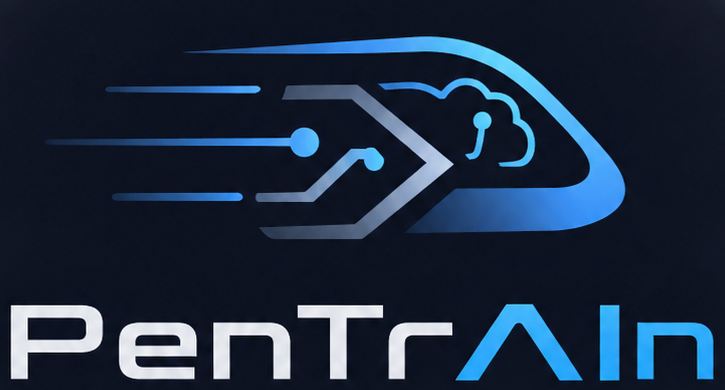

# pentrAIn documentation

  

  <em>Self-hosted pentest training range — quests, a live AI coach, and a browser-based Kali on your own Proxmox.</em>

---

## Start here

| | Guide | What you get |
|---|---|---|
| 🚀 | [**Getting started**](getting-started.md) | Requirements, install modes, setup wizard, your first quest |
| 🖥️ | [**The workspace**](workspace.md) | Session UI: console, panels, flags, resets, Kali internet |
| 🤖 | [**The AI coach**](coach.md) | Autonomy levels, tools, subagents, slash commands, guardrails |
| 🗺️ | [**Tracks & quests**](tracks.md) | All 13 tracks, progression rules, exams, scoring |

## Operate

| | Guide | What you get |
|---|---|---|
| ⚙️ | [**Configuration**](configuration.md) | Every settings key + every env var |
| 🛠️ | [**Ops runbook**](ops.md) | Logs, resets, backups, pack rollout, AD/WiFi caveats |
| 🩺 | [**Troubleshooting**](troubleshooting.md) | Symptom → cause → fix |
| 🔒 | [**Security**](SECURITY.md) | Threat model, isolation, auth, coach guardrails |

## Understand

| | Guide | What you get |
|---|---|---|
| 🏗️ | [**Architecture**](architecture.md) | Component map, lifecycle, event flows, data model |
| 🔌 | [**API reference**](api-reference.md) | REST + WebSocket surface, coach-internal API |
| 🧪 | [**Development**](development.md) | MockProvider dev loop, tests, project layout |
| ✍️ | [**Quest authoring**](quest-authoring.md) | `quest.yaml` schema, roles, checkpoints, exam rules |
| 🏁 | [**Agent eval**](agent-eval.md) | Blind full-auto benchmark runs (`cap-t3-nordwind`) |

## Design decisions

The [ADR index](adr/) explains *why* the platform looks the way it does:

| ADR | Decision |
|---|---|
| [0001](adr/0001-ludus-as-range-engine.md) | Ludus as the external range engine |
| [0002](adr/0002-console-via-proxmox-novnc.md) | Kali console via Proxmox noVNC proxy |
| [0003](adr/0003-coach-autonomy-levels.md) | Four-level coach autonomy model |
| [0004](adr/0004-two-install-modes.md) | Nested vs direct install modes |
| [0005](adr/0005-coach-reaction-model.md) | Silence-by-default coach reaction model |
| [0006](adr/0006-coach-native-tool-calling.md) | Native LLM tool calling for coach actions |

## Media

All screenshots and GIFs in these docs are generated from a disposable
MockProvider demo stack — see [`media/README.md`](media/README.md) for the
capture pipeline and how to regenerate them.
