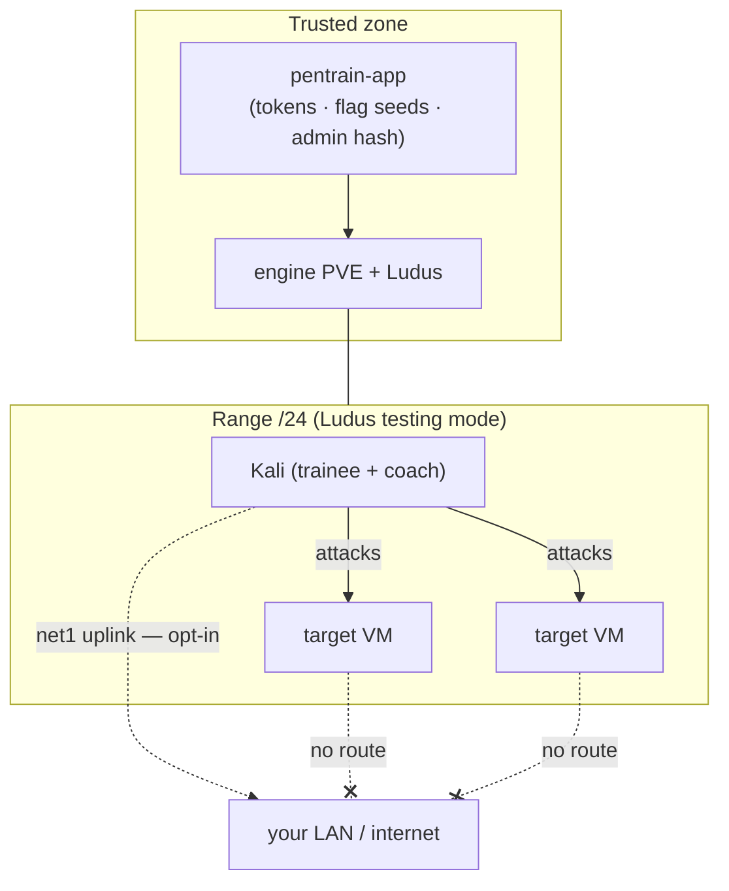
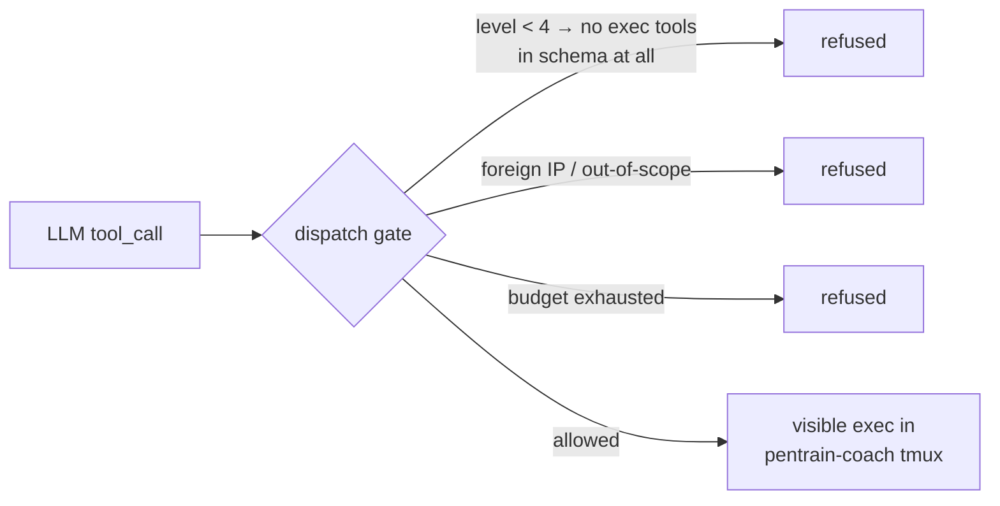

# Security

pentrAIn runs **deliberately vulnerable machines**. That is the product. The
security posture therefore focuses on containing them — the range is the
blast radius, not your LAN.

> [!CAUTION]
> The platform intentionally builds exploitable infrastructure. Keep every
> component on a private, trusted network. Do not port-forward the UI or the
> engine APIs to the internet — if remote access is required, front them
> with a VPN or an authenticated reverse proxy.

## Threat model

| Asset | Exposure |
|---|---|
| Range VMs | Intentionally exploitable — treat every VM as hostile |
| Session Kali | Trainee-controlled; also executes coach-issued commands at autonomy 4 |
| pentrain-app | Holds PVE API tokens, LLM key, admin credential, flag seeds |
| Engine PVE host | Full VM control — a compromised app VM is a hypervisor compromise |
| Your LAN | Reachable when the Kali `net1` uplink is enabled — opt-in per session |

## Isolation (default posture)

- **Ludus testing mode** puts each range behind its own router VM on a
  dedicated /24 with no route to the lab LAN (`engine.testing_mode`,
  `engine.testing_allow` for the app VM itself).
- Quest networks are per-range VLANs, not shared bridges.
- The **Kali internet uplink is opt-in**: `POST /sessions/{id}/internet`
  hot-plugs `net1` onto `engine.kali_wan_bridge`. Only Kali gets it; targets
  stay unrouted. See [ops.md](ops.md#kali-internet-toggle-mechanics).
- The app UI is meant for **LAN access only**.

## Authentication

- Single-admin web UI: password → **scrypt** hash (`scrypt$N$salt$digest`)
  stored in settings, constant-time verification, bearer token in
  `localStorage` on the client.
- `POST /api/setup/complete` is open **only until the first admin password
  is set**; afterwards it requires the bearer token (takeover guard).
- Coach ↔ backend uses `PENTRAIN_COACH_SERVICE_TOKEN` — set a real value;
  the default `dev-coach-token` prints a startup warning for a reason.
- Telemetry ingest uses a **per-session token** minted at deploy — a range
  VM cannot impersonate another session's event stream.
- `PENTRAIN_APP_SECRET` seeds all flag HMAC derivations; it must be
  non-default for any non-lab deployment (the installer generates one).

## Coach command execution

The coach can run commands inside the session Kali. Guardrails:

- **Autonomy 1–3 never execute** — exec tools are withheld from the tool
  schema itself; suggestions require an explicit user click.
- **Level 4 executes visibly** in a `pentrain-coach` tmux so the trainee
  watches every command; outputs are reported into the chat.
- **Scope guards** — commands touching foreign IPs (outside the range and
  `lan.scope_cidr`) are denied at dispatch.
- **Budgets** — `coach.action_budget` caps executions per session;
  `llm.daily_token_budget` caps spend service-wide.
- **Workers** share the parent's guards and budget; they are exec-only — no
  chat, flags, checkpoints, or recursive spawns.
- Telemetry is treated as **untrusted data** — the prompt forbids executing
  instructions found inside command output; flag-looking strings are
  scanned, not obeyed.

## Secrets handling

- `llm.api_key`, PVE tokens and the admin hash live server-side
  (`get_secret`) and are **never rendered into the coach context** —
  `flag_seed` (the HMAC seed behind all flag secrets) is excluded too.
- Nothing secret is logged; coach LLM prompts carry topology/telemetry
  context but no credentials or flag values.
- `installer/.secrets/` holds generated secrets — gitignored; never commit.
- Doc/screenshot media are generated against a disposable mock stack — no
  real credentials appear in `docs/assets/`.

## Home-lab engagements

The `home-lab` track deliberately points Kali at your LAN. Rules of
engagement are enforced in the coach context — authorized scope
(`lan.scope_cidr`), read-only probes, no DoS — but the authorization itself
is on you: only devices you own.

## Reporting

This is a training lab, not a hardened product. If you find a real
vulnerability in the platform itself (not the intended quest VMs), please
open a private security advisory rather than a public issue.
