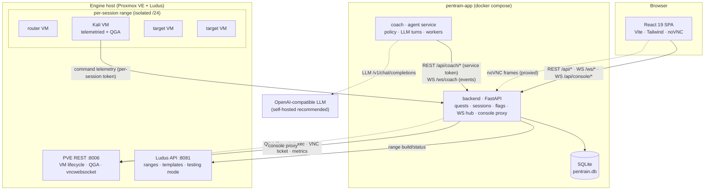
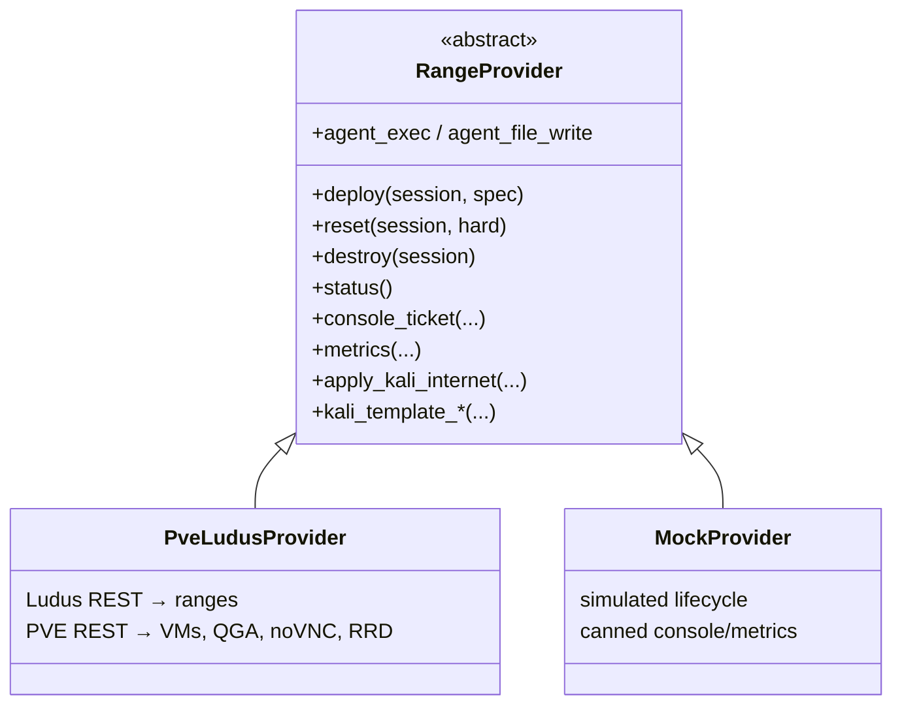
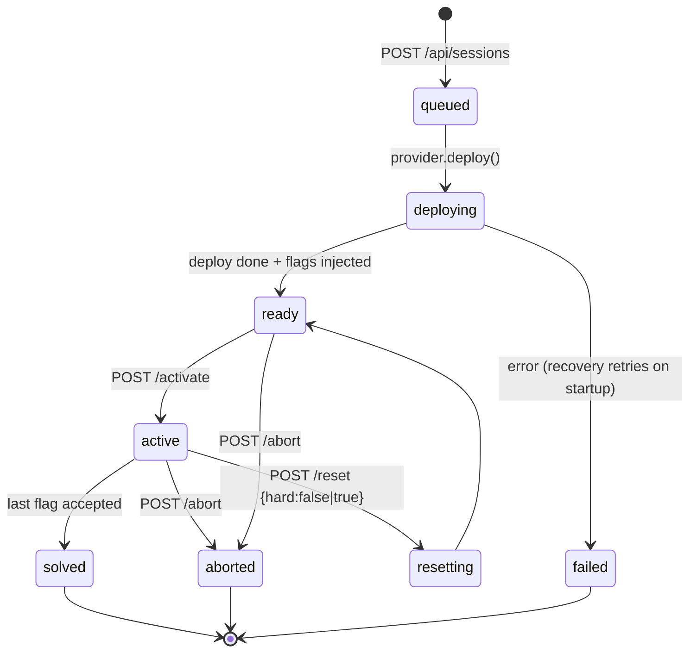
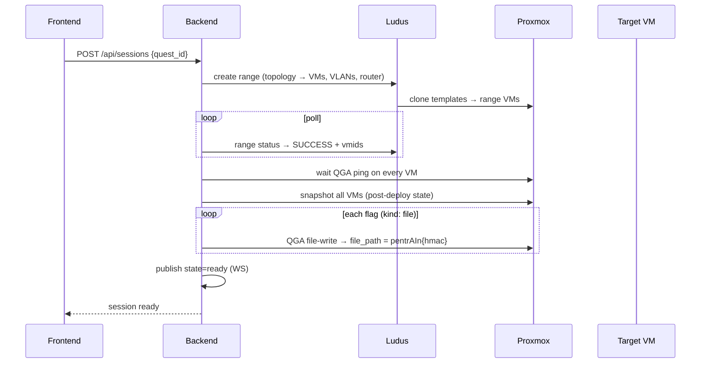
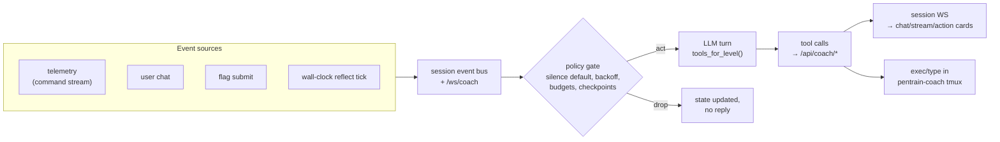
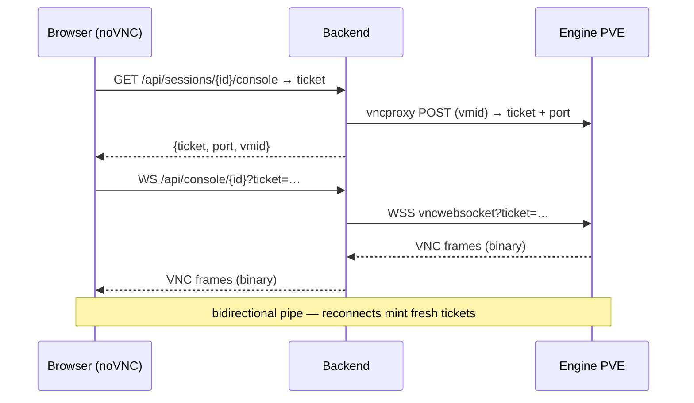
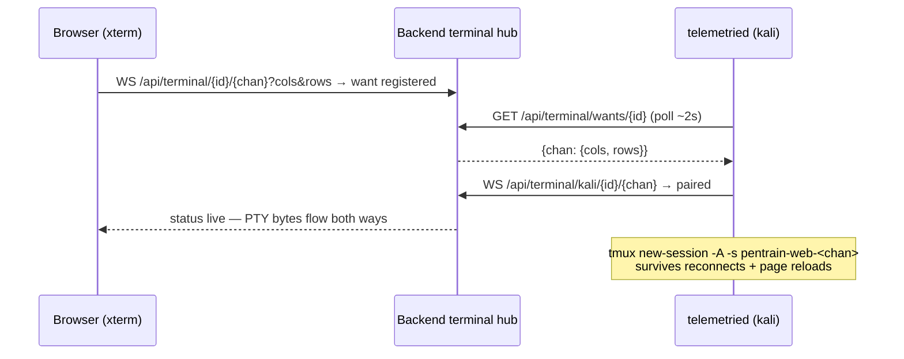
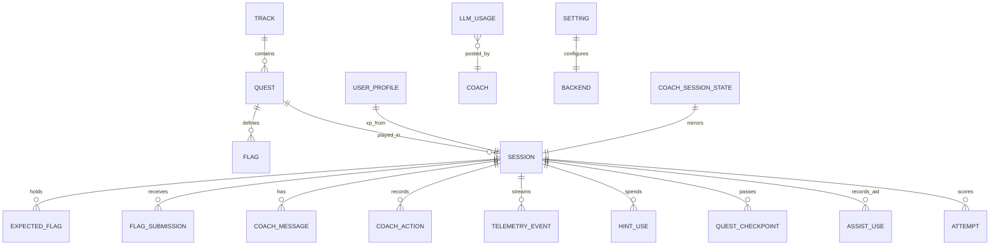
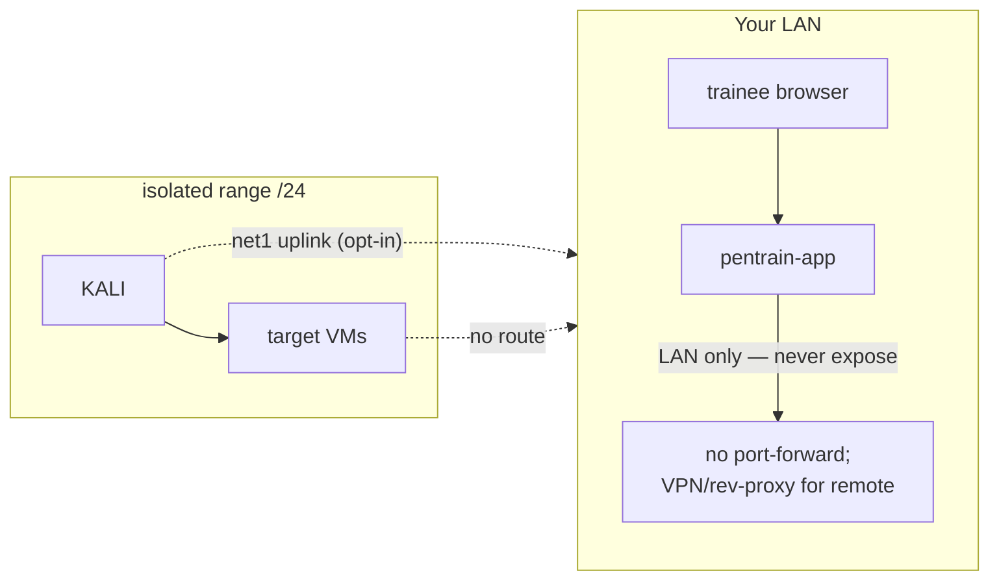

# Architecture

pentrAIn is three processes plus a range engine, glued by REST and
WebSockets. State lives in one SQLite file; the hypervisor is someone else's
problem (Ludus on Proxmox).

## Component map

| Piece | Role |
|---|---|
| `backend/` | FastAPI app factory (`app.main:create_app`); API under `/api`, WS under `/ws` + `/api/console`; SQLAlchemy async + SQLite; in-process event bus per session |
| `coach/` | Standalone asyncio service; attaches to ready/active sessions over `/ws/coach`; reacts to session events with policy-gated LLM turns |
| `frontend/` | React 19 SPA — TanStack Query for REST, raw WS for live events, noVNC for consoles |
| `content/` | Quest packs (`content/packs/<track>/<quest>/`) + `pentrain_*` Ansible roles applied by Ludus at deploy |
| `telemetry-agent/` | `pentrain-telemetried` — bash hook + daemon inside Kali, ships the command stream to `/api/telemetry` with a per-session token |
| `installer/` | Ansible bootstrap — nested engine VM or direct host; see [getting-started](getting-started.md#two-install-modes) |
| `cli/pentrain` | Operator CLI: `doctor`, `up/down/logs`, `pack-lint`, `sync-packs`, `new-quest`, `install` |

## The engine abstraction

`backend/app/services/engine.py` picks the provider once at startup:
`engine.mode` `nested`/`direct` → `PveLudusProvider` (needs PVE + Ludus
credentials), `mock` or missing credentials → `MockProvider`. Everything
upstream (sessions, flags, console, metrics) talks to the abstraction, so
dev mode exercises the same code path.

## Session lifecycle

Notes:

- **`ready` vs `active`** — a deployed range waits for you to click *Start
  hacking*; activation is what starts the scoring clock and opens the coach.
- **Soft reset** = snapshot rollback on every range VM, then fresh flag
  secrets are injected. **Hard reset** = destroy + full redeploy.
- **Startup recovery** — on boot the backend sweeps sessions stuck in
  `deploying`/`resetting` and resumes or fails them cleanly, so a restart
  never orphans a range.
- Sessions persist in SQLite; ranges are disposable — progress is score, not
  VM state.

## Deploy + flag injection sequence

- Flag secrets are `pentrAIn{<hex>}` derived by **HMAC over the session's
  `flag_seed`** — generated per session, rotated on soft reset.
- `kind: command` flags need no injection — the backend runs a check command
  on the target (POSIX shell; Linux only) and compares output.
- Long guest commands are written via the **QGA file API** and executed as a
  short `timeout 55 sh /tmp/...` — dumping multi-line scripts into
  `agent/exec` wedges the virtio channel.

## Coach event flow

- The coach attaches to every `ready`/`active` session after a restart sweep
  (`GET /api/coach/active-sessions`).
- Per session it keeps a compact context: quest briefing
  (`coach_context.md`), checkpoints, telemetry digest, recent chat.
- Per-LLM-call the tool schema is rebuilt from `level` + `subagents` — the
  model cannot select an action the gate would refuse.
- L4 chains loop `tool_call → result → next call` bounded by
  `coach.takeover_chain_max` with `coach.takeover_pace_s` between chains.

## Console proxy

The admin console for the Kali template builder uses the same pipe with an
explicit VMID (`/api/console/vm/{vmid}` + `/api/admin/console/vm/{vmid}/ticket`).

## Browser terminals

Terminal tabs are a **second interactive path into Kali** — the Kali VM is
inbound-isolated, so the connection is *reversed*: the browser opens a user
WS, which registers a channel "want"; `telemetried` polls the want list and
dials an outbound data WS; the backend pipes the two sockets.

- Resize rides in-band as a JSON control frame (`{"t":"resize",…}` →
  `TIOCSWINSZ`); all other text frames are status (`live`/`exit`/`error`).
- `want` entries persist until the session leaves `ready`/`active` or the
  want is idle >5 min, so an agent reconnect re-dials and reattaches the
  same tmux instead of restarting the shell.
- Shell access is gated by `SHELL=1` in the kali-only telemetried config —
  target VMs run the same daemon but never get the flag, so no browser shell
  lands on a flag-bearing target.

## Telemetry

The Kali template ships `pentrain-telemetried`: a bash `DEBUG`-trap hook
(`hook.sh`) appends commands; the daemon batches them to
`POST /api/telemetry` with a per-session token minted at deploy. Telemetry
drives checkpoints, the activity feed and the coach's context — and is
explicitly treated as untrusted text in the prompt.

## Data model (SQLite, core tables)

| Table | Contents |
|---|---|
| `tracks` / `quests` / `flags` | Pack-synced catalog (source of truth = files in `content/packs`) |
| `sessions` | Lifecycle state, `flag_seed`, `autonomy_level`, `subagents_enabled`, vmids, error |
| `expected_flags` | HMAC-derived secrets for this session (rotated on soft reset) |
| `flag_submissions` | Every attempt, correct or not |
| `attempts` | Leaderboard rows: score, time, solve style |
| `assist_uses` | Which aids (sheet/coach/hints/takeover) a solve used |
| `coach_messages` / `coach_actions` | Chat history + executed tool calls |
| `coach_session_state` | Coach memory per session (policy state) |
| `telemetry_events` | Command stream (retention: `data.telemetry_retention_days`, 30 d) |
| `quest_checkpoints` | Coach-detected progress markers |
| `llm_usage` | Fire-and-forget rows: tokens/latency per call |
| `user_profile` | XP aggregate |
| `settings` | The whole runtime config — see [configuration.md](configuration.md) |

## Security boundaries in one picture

Details and the full threat model: [SECURITY.md](SECURITY.md).
