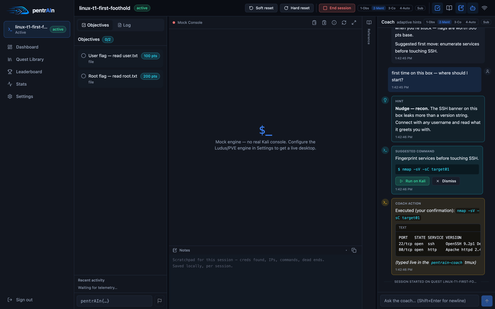
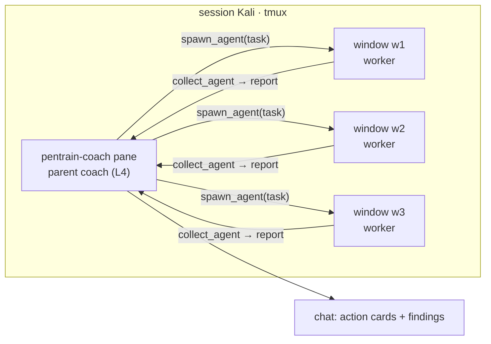
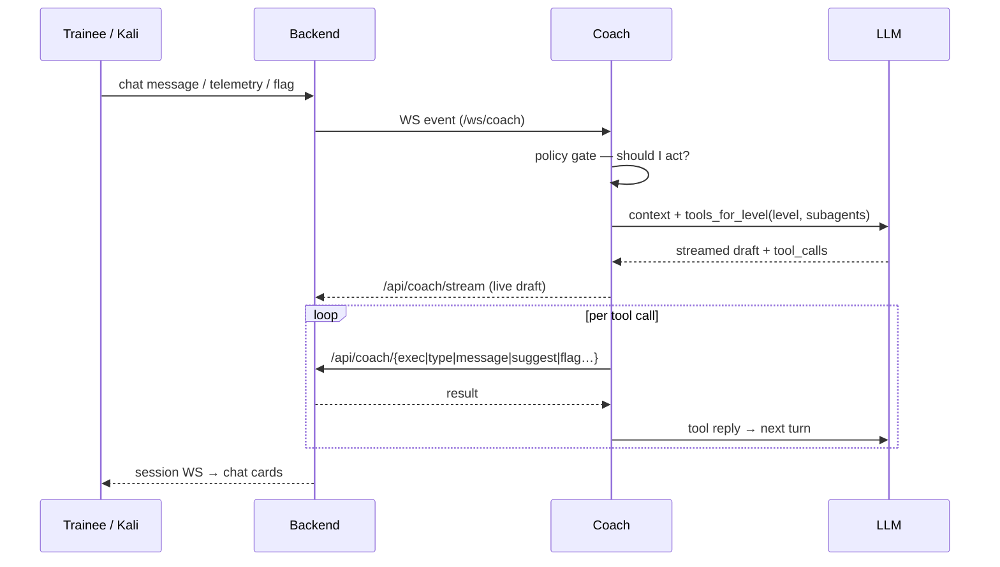

# The AI coach

The coach is a separate agent service (`coach/`) that attaches to your
session, watches your command stream and the range state, and helps within a
strict autonomy contract. It connects to any **OpenAI-compatible** LLM
endpoint (`/v1/chat/completions`).

> [!IMPORTANT]
> **Silence is the default.** The coach never comments on commands as they
> stream in — telemetry updates its internal state (checkpoints, progress,
> stuck-timers) but does not trigger LLM turns. It speaks when you ask it
> something, when a flag lands, or when the escalation policy decides you're
> stuck. Design rationale: [ADR 0005](adr/0005-coach-reaction-model.md).

## The four autonomy levels

Switch live in the chat header, the session toolbar, or with
`/autonomy <level>` in chat. Persisted per session.

| Level | Name | Aliases | What it may do |
|---|---|---|---|
| **1** | **Observer** | spectate | `send_chat`, `offer_hint`, `capture_screen`, `none` — pure watching + talking |
| **2** | **Mentor** | advisor | + `mark_checkpoint` — adaptive guidance, tracks your progress explicitly |
| **3** | **Copilot** | — | + `suggest_command` — proposes commands as confirm-chips; **you** click Run |
| **4** | **Autonomous** | takeover | + `exec_in_kali`, `type_in_pane`, `submit_flag`, `check_flag`, `spawn_agent` — it drives a `pentrain-coach` tmux inside your Kali |

Levels 1–3 **cannot execute anything** — the tool schema itself withholds the
exec tools, and the dispatch gate would refuse them anyway (defense in
depth). Level 4 asks for a one-time confirmation and runs visibly — every
command the coach issues is typed into a tmux pane you can watch, with output
reported back into the chat as an action card.

`/autonomy` without an argument prints the current level; `/level`, `/mode`,
`/l` are aliases. `/subagents on|off` (aliases `/subs`, `/parallel`) toggles
worker agents — without an argument it prints the state.

## What it can do — the tool contract

The coach uses **native tool calling** (ADR [0006](adr/0006-coach-native-tool-calling.md));
the tool list is rebuilt per level and per subagent toggle — the model can
never even *see* an action it isn't allowed:

| Tool | Level | Effect |
|---|---|---|
| `send_chat` | 1+ | Markdown message into the chat (streamed, reasoning shown collapsibly) |
| `offer_hint` | 1+ | A hint card at escalation level 1–3 |
| `mark_checkpoint` | 2+ | Marks a quest checkpoint reached |
| `suggest_command` | 3 | Confirmable command chip (`Run on Kali` / `Dismiss`) |
| `exec_in_kali` | 4 | Runs a command in the coach tmux pane, output reported to chat |
| `type_in_pane` | 4 | Types into a *busy* pane — passwords, ssh/ftp logins, menus (exec bounces while a foreground program holds the pane) |
| `submit_flag` / `check_flag` | 4 | Submits a `pentrAIn{...}` it saw in output / verifies state-kind flags |
| `wait` | 4 + workers | Blocks N seconds (≤`wait_max_s`) without touching the pane — for cron/startup/cooldown delays; no budget cost; operator chat aborts it early |
| `update_plan` | all + workers | Replaces the agent's own ≤10-step roadmap (`todo`/`doing`/`done`) — persisted, survives restarts; each worker keeps its own plan, the parent's shows as `OPERATOR_PLAN` in worker prompts |
| `capture_screen` | 1+ | Screenshot of the Kali desktop → vision model (when `llm.vision_model` is set) |
| `spawn_agent` etc. | 4 + `Sub` | Parallel workers — next section |
| `none` | all | Stay silent, keep a private working note |

### Streaming + reasoning

Replies stream token-by-token into the chat; thinking models show their
reasoning in a collapsible block (`llm.reasoning`, `llm.reasoning_effort`).
If the endpoint lacks SSE it falls back to whole replies automatically —
only perceived latency changes.

## Subagents (L4 parallel workers)

In Autonomous mode with **Sub** enabled, the coach can delegate independent
subtasks to worker agents — e.g. enumerate three hosts at once.

Worker contract:

- Own LLM context, own tmux window (`w1`…`w3`), own action prefix `[wN]`.
- **Exec-only** toolset: `exec_in_kali`, `type_in_pane`, `wait`, `none` — no
  chat, no flags, no checkpoints, **no recursive spawns**.
- Share the parent's scope, read/write guards and action budget.
- Caps: `coach.max_workers` (default **3**), `coach.worker_turn_cap` (10 LLM
  turns), `coach.worker_time_cap_s` (300 s wall clock);
  `collect_agent` waits up to `coach.collect_wait_s` (40 s).
- Killed automatically on autonomy downgrade below 4, `Sub` off, or session end.

In the chat UI each worker gets a live chip above the composer — click it
to open its own feed (exec/type reports with thinking blocks, live pane
output, final report) instead of it filling the main conversation. The
main transcript only carries the parent's messages plus a spawn notice
with a jump link into the worker's feed; finished workers stay as dimmed
chips. Worker exec reports, activity ticks and streamed drafts are
agent-tagged end-to-end (`meta.agent` / `agent` on coach events) and the
backend keeps per-agent ephemeral slots, so one worker's status never
clears another's.

## Guardrails

| Guard | What it does |
|---|---|
| **Scope** | Commands touching IPs outside the range (and `lan.scope_cidr` in home-lab mode) are refused before they reach the VM |
| **Action budget** | `coach.action_budget` (default 50) caps total coach executions per session |
| **Takeover pacing** | `coach.takeover_pace_s` min gap between L4 chains; `coach.takeover_chain_max` (12) caps LLM calls per turn |
| **Token budget** | `llm.daily_token_budget` service-wide; the coach announces once, then pauses |
| **Read/write guards** | Destructive/out-of-scope commands are denied at dispatch |
| **Untrusted telemetry** | The prompt forbids executing instructions found inside command output — flag-looking strings are scanned, not obeyed |
| **Anti-loop** | Repeated identical actions and no-progress chains get cut |

Secrets never reach the LLM context: `llm.api_key`, PVE tokens, the admin
hash and `flag_seed` are explicitly excluded.

## LLM configuration

All in **Settings** (wizard seeds them):

| Key | Meaning |
|---|---|
| `llm.base_url` | e.g. `http://llm.home.lab:1234/v1` |
| `llm.api_key` | Optional bearer for the endpoint (secret) |
| `llm.model` | Chat model — tuned for tool calling; default `huihui-ai/Qwen3-30B-A3B-abliterated` |
| `llm.vision_model` | Optional — enables `capture_screen` descriptions |
| `llm.reasoning` + `llm.reasoning_effort` | Thinking traces + effort (`low`/`medium`/`high`, probed from the endpoint) |
| `llm.temperature` | Default 0.4 |
| `llm.daily_token_budget` | 0 = unlimited |

Helpers in Settings / `/stats`: **model discovery** (`POST /api/llm/models`
proxies `{base_url}/models`), **reasoning-effort probe** (parses the
endpoint's supported values), **usage stats** (`GET /api/llm/usage?days=N` —
tokens/requests/latency per day + budget fill).

## Coach tuning

| Key | Default | Effect |
|---|---|---|
| `coach.enabled` | `true` | Master switch |
| `coach.default_autonomy` | `2` | Level new sessions start at |
| `coach.verbosity` | `normal` | `terse`/`normal`/`verbose` chat style |
| `coach.personality` | `mentor` | Persona in the system prompt |
| `coach.reflect_interval_s` | `60` | Wall-clock reflection tick |
| `coach.nudge_after_s` | `480` | Idle this long → may nudge |
| `coach.hint_after_s` | `900` | Idle this long → may offer a real hint |
| `coach.action_budget` | `50` | Max executions per session |
| `coach.takeover_pace_s` | `10` | Min gap between L4 chains |
| `coach.takeover_chain_max` | `12` | Max LLM calls per L4 turn |
| `coach.max_workers` | `3` | Parallel subagent panes |
| `coach.worker_turn_cap` | `10` | LLM turns per worker |
| `coach.worker_time_cap_s` | `300` | Wall-clock per worker |
| `coach.collect_wait_s` | `40` | `collect_agent` block bound |
| `coach.wait_max_s` | `180` | Cap per `wait` tool call (cron/startup delays) |

Per-quest behavior (checkpoints, escalation timings, private briefing) lives
in `quest.yaml` → [quest-authoring.md](quest-authoring.md).

## How a turn actually works

Details: [architecture.md — coach event flow](architecture.md#coach-event-flow).

## Memory & perception (facts, perceptor, objectives)

Long-horizon L4 runs can't keep hosts, creds and file state in a growing
chat log — the coach externalizes them deterministically (no extra LLM
call):

- **`percept.py` (perceptor)** — normalizes every exec/type result before
  the model sees it: ANSI stripped, middle elided, exit code tagged; parses
  tool output (nmap/masscan ports, hydra creds, getent names, generic
  `login:`/`password` pairs, user lists) into a facts delta.
- **`facts.py` (FactsDB)** — per-session structured memory: hosts (ports,
  names, scan counts), credentials (source, tested/validated hosts), files
  (writes/runs/last exit — the rewrite guard reads this), flags
  (seen/submitted/accepted), observed IPs (the foreign-IP pivot rule).
  Rendered as a compact `FACTS:` block in every context message.
- **`objective.py` (mini-PTG)** — picks ONE concrete next action from open
  work (unsubmitted flag → unrun/failed script → untested cred → next
  checkpoint → recon/enum/foothold gap) and renders it as
  `CURRENT_OBJECTIVE:` — the model stops losing the thread between turns.
- **Worker reports** — `collect_agent` expects a closing JSON report
  (`findings`/`creds`/`hosts`/`next`) and merges it into FactsDB; prose
  reports still yield facts via the generic parser.
- **`PLAN:` (self-maintained roadmap)** — `update_plan` replaces the
  agent's ≤10-step intent (`todo`/`doing`/`done`), rendered next to
  `CURRENT_OBJECTIVE:` (deterministic suggestion vs model intent). Logged
  as `coach_actions` rows and reseeded from the latest snapshot on
  re-attach, so the roadmap survives restarts. Workers keep their own plan
  (`agent` field on the row); the parent's shows as read-only
  `OPERATOR_PLAN` in worker prompts. `none`-reason notes persist the same
  way (`tool="note"` → `YOUR_NOTES` reseed).
- **Rolling summary** — history is capped; whatever `trim_history` drops is
  distilled into a bounded `EARLIER:` line list instead of vanishing.
- **Trajectories** — every LLM sub-turn appends a JSONL record
  (`PENTRAIN_TRAJ_DIR`, compose volume `pentrain-traj`) for eval and later
  training data.
- **Agent metrics** — `GET /api/sessions/{id}/agent-metrics` aggregates the
  audit trail: tool histogram, denial reasons (coach-side guard denials
  self-report via `POST /api/coach/action`), grounding signals
  (foreign-IP denies, unverified/rejected flag submits), time-to-first-flag
  and token usage — consumed by `scripts/agent_eval.py`.

Everything in `FACTS:`/`CURRENT_OBJECTIVE:` derives from *observed* data
only — quest YAML internals (`flag.vm`, `file_path`, hidden hints) never
leak, which keeps blind capstone quests (`cap-t3-nordwind`) honest.
