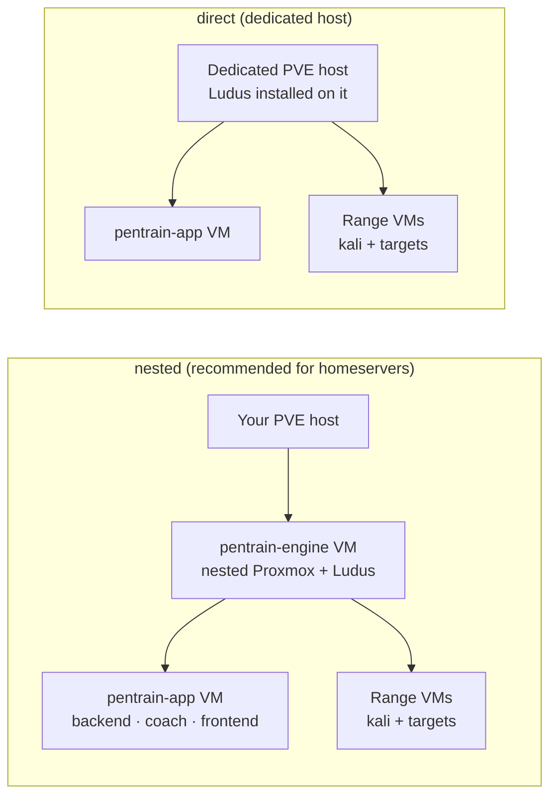
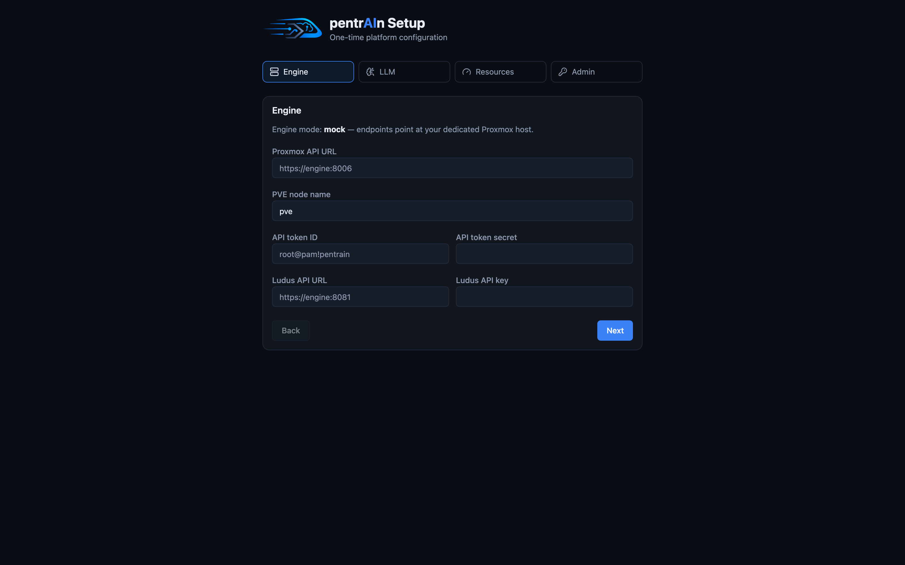
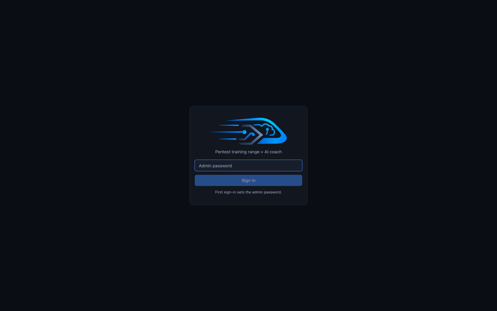
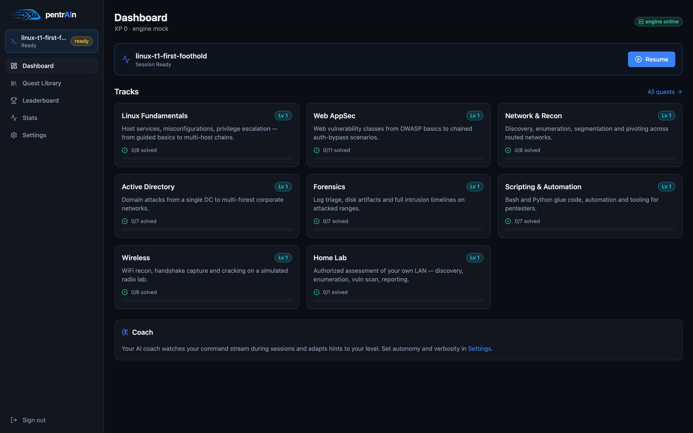
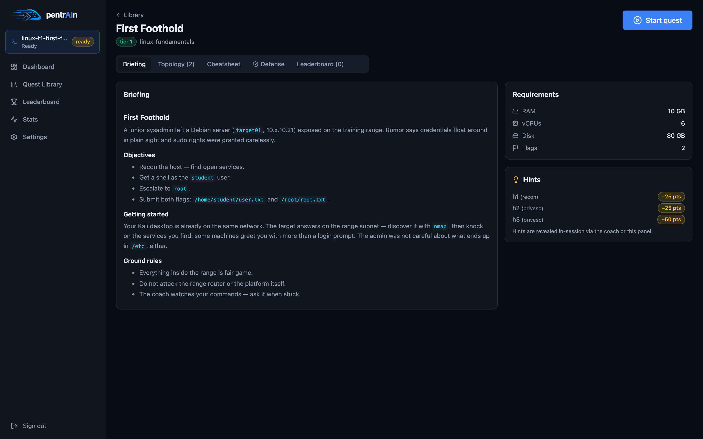
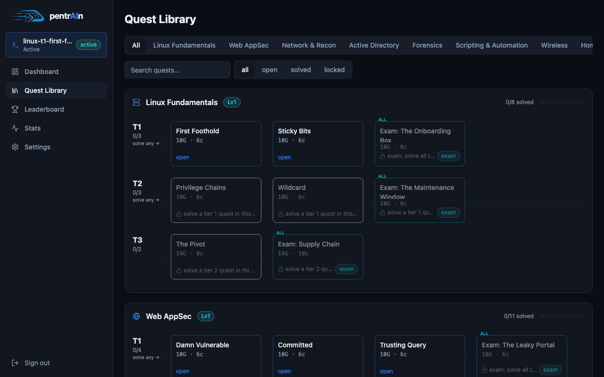

# Getting started

This guide takes you from a bare Proxmox host to your first solved quest.

> [!IMPORTANT]
> pentrAIn deploys **deliberately vulnerable VMs**. Everything it builds is
> meant to be attacked — keep it on a private LAN and read
> [SECURITY.md](SECURITY.md) before exposing anything.

## What you need

| Requirement | Why |
|---|---|
| **Proxmox VE 8.x host** | Runs the range engine (Ludus) and all VMs |
| **Ansible ≥ 2.15** on your admin machine | Drives the installer |
| **PVE API token** with VM/admin rights | The app and installer talk to the PVE REST API |
| **An OpenAI-compatible LLM endpoint** | Powers the coach — a self-hosted model (LM Studio, llama.cpp, vLLM) works great; any `/v1/chat/completions` API does |
| **~100 GB free, 16+ GB RAM** on the engine | Templates + running ranges; more for AD quests |

> [!TIP]
> No Proxmox? The whole app — UI, session lifecycle, coach plumbing — runs
> against a **MockProvider** for development. See
> [development.md](development.md) and skip to "Development mode" at the bottom.

## Two install modes



| Mode | Choose when | Trade-off |
|---|---|---|
| `nested` | You have **one** existing PVE host and want pentrAIn contained | One large VM carries everything; needs nested virtualization |
| `direct` | You can dedicate a whole PVE host to pentrAIn | Ludus owns templates/networks/users on that host — **do not** run it alongside other workloads |

Full design rationale: [ADR 0004 — two install modes](adr/0004-two-install-modes.md).

## Install

```bash
cd installer
cp inventory.example.yml inventory.yml   # fill in your PVE host + API token
./install.sh --mode nested               # or: --mode direct
```

The installer prints a live status board (stage, running task, elapsed time,
counters) and writes the full Ansible log to `installer/logs/install.log`.

| Flag | Effect |
|---|---|
| `--with-templates` | Also build the Ludus VM templates (kali, debian, win2022) — multi-GB, multi-hour; needed for Windows/AD quests |
| `--i-know-dedicated` | Required for `direct` on a host that already runs VMs/CTs |
| `--yes` / `-y` | Skip the confirmation prompt |
| `--verbose` | Raw Ansible output instead of the status board |

> [!WARNING]
> `direct` mode is destructive on a shared host: Ludus manages users, networks
> and templates globally. Only use it on a dedicated machine — the
> `--i-know-dedicated` flag exists to make that a conscious decision.

> [!TIP]
> The installer is idempotent — re-running the same command resumes past
> already-done tasks. Non-interactive shells get plain output automatically
> (`PENTRAIN_UI=plain` or `NO_COLOR=1` to force it).

## First boot — the setup wizard

Open `https://<pentrain-app-ip>` and walk the four-step wizard:



| Step | What it configures |
|---|---|
| **Engine** | `engine.mode`, PVE API URL + token, Ludus URL + key |
| **LLM** | `llm.base_url`, `llm.model`, optional vision model + reasoning effort |
| **Resources** | `resources.max_*` budget — quests that don't fit stay locked |
| **Admin** | The single-admin password (scrypt, server-side only) |

> [!NOTE]
> `POST /api/setup/complete` is only open while no admin password exists —
> the wizard literally cannot be re-run by a stranger after first login.
> To reconfigure later, use **Settings**.

## Sign in



Single-admin app: one password, bearer token in `localStorage`. The first
sign-in **sets** the password.

## Your first quest



1. **Dashboard → Tracks** — start with *Linux Fundamentals → First Foothold*
   (tier 1 is always unlocked).
2. **Read the briefing** — goal, ground rules, requirements, hint costs.

   

3. **Start quest** — the backend asks Ludus for a fresh range: router VM,
   your Kali, the target VM(s). Deploy takes a few minutes
   (`est_deploy_min` per quest is honest).
4. **Start hacking** — the workspace mounts a noVNC console to your Kali,
   objectives on the left, coach on the right.

   

5. **Submit flags** — find `pentrAIn{...}` secrets on the targets and type
   them into the flag box. Objectives tick off live and the leaderboard
   scores you.

That's the whole loop: **brief → deploy → hack → flag → solve**. Everything
else — hints, coach autonomy, resets, scoring — builds on it.

## Development mode (no hypervisor)

```bash
make dev     # backend + coach + frontend against MockProvider
```

MockProvider simulates deploy → ready → reset with a placeholder console, so
every UI flow (sessions, flags, coach chat, leaderboards) works on a laptop.
See [development.md](development.md).

## Where to next

- [The workspace](workspace.md) — every panel and control in the session view
- [The AI coach](coach.md) — autonomy levels and what the agent can do
- [Tracks & quests](tracks.md) — progression, exams, scoring
- [Configuration](configuration.md) — every knob, in one table
