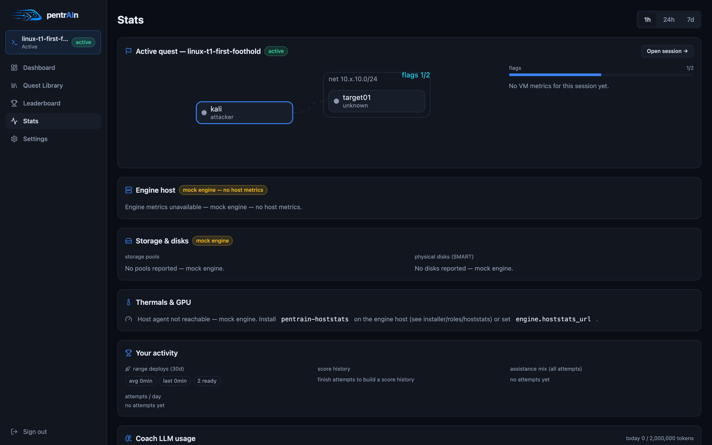
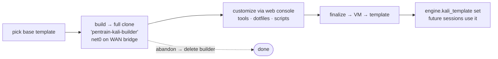
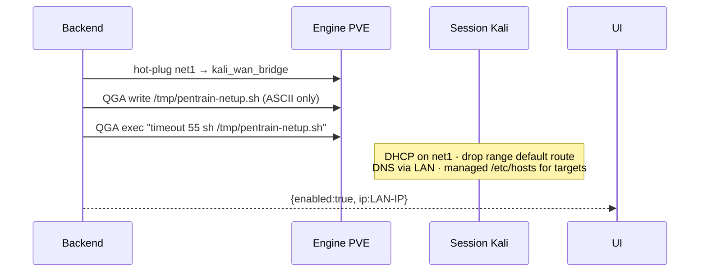

# Ops runbook

Day-2 operations for the pentrain-app stack (backend, coach, frontend,
SQLite). For symptom→fix lookup see [troubleshooting.md](troubleshooting.md).

## CLI

`cli/pentrain` — thin wrapper, run from a repo checkout on the app host:

```text
doctor         full environment diagnostic — start here
up|down|logs   docker compose lifecycle (engine/docker-compose.yml)
build          rebuild images
engine-status  provider health + resource caps
pack-lint      scripts/lint_packs.py
new-quest      scaffold a quest (+ --role)
sync-packs     re-import content/packs into the DB
install        run the Ansible installer
```

`engine-status` and `sync-packs` send `PENTRAIN_TOKEN` when set — required
once an admin password is configured.

## Logs

```bash
docker compose -f engine/docker-compose.yml logs -f backend
docker compose -f engine/docker-compose.yml logs -f coach
```

Useful signals: `coach attached`, `deploy finished`, `packs synced`,
`llm call failed`, `event stream dropped, reconnecting`.

## Stats page (`/stats`)



Three panels:

- **Engine host** — CPU/RAM/network/load time series proxied live from PVE
  `GET /nodes/{node}/rrddata` (`GET /api/engine/metrics?timeframe=hour|day|week|month`).
  Mock engine → panel degrades to "unavailable"; nothing is stored locally.
- **Session VMs** — live per-VM gauges (cpu, ram, balloon target) via
  `GET /api/sessions/{id}/metrics` → `qemu/{vmid}/status/current`, 15 s refresh.
- **Coach LLM usage** — the coach posts a fire-and-forget row per request to
  `POST /api/coach/llm-usage`; `GET /api/llm/usage?days=N` aggregates
  tokens/requests/latency per day plus the daily-budget fill level. Rows live
  in `llm_usage` (~200 B each, no retention job needed).
- **Hoststats** — CPU temps/GPU/fans when `engine.hoststats_url` (or the
  `:9100` default derived from `pve_url`) answers.

> [!TIP]
> The reasoning-effort dropdown is probed from the endpoint:
> `POST /api/llm/reasoning-efforts` sends an invalid effort and parses the
> "Supported values: …" reply. Endpoints that ignore the field get the union
> fallback, marked "· defaults" in the UI.

## Kali template builder

Settings → *Kali workspace* → **Template builder** — the guided way to bake a
custom Kali:



- One builder VM at a time, tracked by `kali.builder_vmid`.
- The builder VM lands on `engine.kali_wan_bridge` (default `vmbr0`) so it
  has real internet for `apt`/tools — it is *not* in a range.
- Console opens via the admin pipe (`/api/console/vm/{vmid}`).
- Finalize converts to template and writes `engine.kali_template` — from
  then on every new session's Kali clones *your* box instead of the
  per-quest default.

> [!WARNING]
> Finalizing changes the template **all future sessions** inherit. Verify the
> custom Kali once end-to-end (deploy → telemetry → console) before calling
> it done. `abandon` is the clean rollback — it deletes the builder VM.

## Kali internet toggle mechanics

Session toolbar 📶 → `POST /api/sessions/{id}/internet`:



- Only **Kali** gets the uplink — target VMs stay on the isolated range /24.
- Scripts go through the QGA **file-write API** (long inline exec payloads
  wedge the virtio channel; non-ASCII content crashes pvedaemon's REST path).
- On remove: `net1` detaches first, NetworkManager settles, then route/DNS/
  hosts cleanup runs inside the guest.
- `lan.scope_cidr` bounds what the coach may touch on your LAN (home-lab).

## Resets

| | Soft reset | Hard reset |
|---|---|---|
| Mechanism | Ludus snapshot rollback, all range VMs | Destroy + redeploy |
| Flags | Re-randomized — `ExpectedFlag` rows replaced, old values dead | Re-randomized |
| Identity | Same VMIDs/networks | Fresh range, new VMIDs |
| Use | You broke a target | Range wedged / clean slate |

## Backup

All platform state is the `pentrain-data` volume → `/data/pentrain.db`
(SQLite). Stop the stack, copy the file. User progress, scores, settings and
chat history live there; ranges are disposable by design.

> [!IMPORTANT]
> Back up `PENTRAIN_APP_SECRET` alongside the DB — it seeds all flag HMAC
> derivations. Losing it invalidates flag validation for in-flight sessions.

## Upgrading

Pull → `pentrain build` → `pentrain up`. DB migrations run at backend start.
Changed `quest.yaml` applies to *new* sessions only — running sessions keep
their deploy-time snapshot.

## Rolling out new quests

New quests ship two artifacts that must land in different places:

1. **Packs** — `content/packs/` is mounted read-only into the backend
   container. Update the checkout, run `pentrain pack-lint`, then
   `pentrain sync-packs`. New quests appear in the library immediately;
   progression/exam gates are enforced at session start.
2. **Roles** — `content/ansible-roles/` live on the **PVE host**, not the
   app VM. Ludus only knows roles registered with it:

   ```bash
   # on the PVE host
   rsync -a content/ansible-roles/pentrain_<name>/ /opt/pentrain/ansible-roles/pentrain_<name>/
   for r in /opt/pentrain/ansible-roles/pentrain_*/; do
     ludus ansible role add -d "$r" -g
   done
   ludus ansible roles list | grep pentrain    # verify registration
   ```

   The installer does exactly this on each run — re-running it (or just the
   loop) is the supported resync path. Every role needs `tasks/main.yml` +
   `meta/main.yml` or Ludus refuses it; the pack linter fails early when a
   referenced role dir is missing.
3. Smoke-test one new quest end-to-end before announcing it (deploy → flag
   inject → submit → soft reset). Deploy logs land in the session's Log tab.

### Exam quests

`meta.exam: true` quests render an **EXAM** badge and unlock only after *all*
teaching quests of that track+tier are solved. Nothing extra to deploy — the
gate is backend logic. AD exams reuse the teaching roles plus small
`pentrain_ad_tN_exam*` roles — same template requirements as their tier.

## Windows / Active Directory quests

The `ad-*` quests need Windows templates that are **not** built by default:

- Re-run the installer with `--with-templates`, or trigger the Ludus template
  build manually — `win2022-server-x64-template` (and
  `win11-22h2-x64-template` for `ad-t2`+ workstations). First build takes
  hours and tens of GB.
- Deploy times are long: `est_deploy_min` on AD quests is honest (25–60 min).
- Flag injection needs the **QEMU guest agent** inside the Windows template —
  stock Ludus Windows templates ship it. A failed inject shows up as
  `flag <id> inject FAILED` in the deploy log.
- Windows quests only use `kind: file` flags (`C:\flags\*.txt`) —
  `kind: command` checks run a POSIX shell and are rejected by the linter.
- AD t3 (`ad-t3-kill-chain`) wants ~48 G RAM — check the resource budget or
  `check_unlock` keeps it locked.

## Wireless (hwsim) labs

The `wifi-*` quests simulate 802.11 **inside the target VM** via
`mac80211_hwsim` — no physical radios, no cross-VM wireless (hwsim phys are
kernel-local). Layout:

- `pentrain_wifi_lab` (dependency of every wifi role) loads
  `mac80211_hwsim` at boot, installs `hostapd`/`aircrack-ng`/`hcxdumptool`/
  `hashcat`/`iw`, and drops lab users + wordlists under `/opt/wifi`.
- Quest roles spawn hostapd/wpa_supplicant pairs on the virtual phys —
  `wlan0`+ run the networks, `wlan1` is the trainee's attack interface.
- Trainees reach the lab by SSH from Kali (`wifi` user, creds in the
  briefing); attack tooling lives on the lab VM itself.
- Packaged captures (`files/*.cap`) are REAL hwsim-generated handshakes —
  regenerate with `scripts/make_wifi_handshake.sh <ssid> <psk> <out>` on a
  host with hwsim + wireless tools; validate with `aircrack-ng` before
  committing.
- Cleanup: ranges are destroyed whole, but on a shared host kill leftover
  `hostapd`/`wpa_supplicant`/`airodump-ng` and `modprobe -r mac80211_hwsim`.

## Common problems

See [troubleshooting.md](troubleshooting.md) — coach silence, deploy hangs,
console issues, telemetry gaps, installer quirks.
