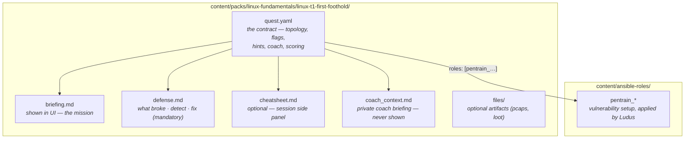
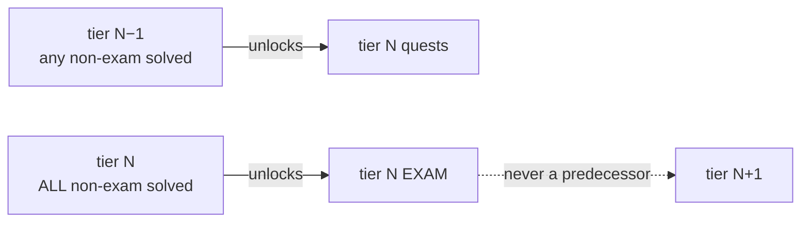

# Quest authoring

A quest is a directory under `content/packs/<track>/<quest-id>/`:



A track may also carry `content/packs/<track>/cheatsheet.md` — a shared
reference card rendered under "Track reference" for every quest in the track.

Validate with `python scripts/lint_packs.py content/packs` — CI runs it.
Missing `cheatsheet.md` is a warning, not an error.

## Cheatsheet conventions

The sheet panel sits next to the console and the coach — it is **reference,
not hint**: tool syntax, host inventory, concepts worth remembering.

| ✅ Allowed | ❌ Not allowed |
|---|---|
| Commands with placeholders (`ssh -J user@<hop>`) | Flag paths |
| Which tools apply | Credentials |
| Non-secret host descriptions | The actual vulnerable parameter |
| "Watch for X" nudges | Anything `hints:` would charge points for |

## quest.yaml

```yaml
apiVersion: pentrain/v1
kind: Quest
meta:
  id: linux-t1-first-foothold     # unique, kebab-case, matches the dir name
  track: linux-fundamentals       # groups quests; ordering via `tier`
  tier: 1                         # progression within the track
  title: "First Foothold"
  exam: false                     # optional — see "Exam quests" below
  version: 1
display:
  tagline: "SSH in with weak creds, escalate via a sudo misconfiguration."
requirements:
  min_ram_gb: 12                  # rejected at session start if over the resource cap
  min_vcpus: 6
  min_disk_gb: 80
  est_deploy_min: 8               # honest estimate — deploys take minutes
```

### Topology

```yaml
topology:
  kali:
    template: kali-x64-desktop-template   # Ludus template name
    ram_gb: 6                             # ballooning max; ram_min_gb sets the floor
    ram_min_gb: 3                         # optional — kali defaults 3, targets ram_gb/2
    cpus: 4
  vms:
    - name: target01
      template: debian-12-x64-server-template
      ram_gb: 2
      cpus: 2
      vlan: 10                            # optional; defaults to the range VLAN
      ip_last_octet: 21                   # stable .21 inside the range /24
      roles: [pentrain_linux_t1]          # Ludus ansible roles → vulnerabilities
```

The Kali VM is implicit per session — add every other box under `vms`.
`ip_last_octet` gives deterministic addresses for briefings and checkpoints;
`.254` is the range router (linted). `requirements.min_ram_gb` should cover
the sum of `ram_gb` plus ~2 G for the implicit router.

`topology.kali.roles` may add quest-specific setup roles to the Kali VM. This
is useful for lightweight, read-only audit quests that need no target VM. Role
names are validated by the pack linter. Keep fixture data synthetic, and use
Kali-side command flags to check a learner-produced report.

#### `setup:` — per-VM post-deploy customization

For tweaks that don't warrant a whole ansible role — dropping a compose
file, planting a config, starting a service — a VM may carry a `setup`
block. It runs on the deployed guest via qemu-guest-agent at finalize,
**before flag injection and before the post-deploy snapshot**, so soft
resets keep the result:

```yaml
    - name: app01
      template: debian-12-x64-server-template
      setup:
        files:
          - path: /opt/app/docker-compose.yml
            content: |
              services:
                web: {image: nginx:alpine, ports: ["8080:80"]}
            mode: "0644"                       # optional octal, default 0644
          - path: /opt/app/blob.bin
            content_b64: "AAEC"               # for non-text payloads
        exec:
          - "cd /opt/app && docker compose up -d"
```

Rules enforced at pack validation: linux guests only (QGA exec needs a
POSIX shell), ≤12 files / ≤8 execs per VM, ≤64 KiB per file, ≤256 KiB
total, absolute paths without `..`, octal modes. Steps run in order and
log to the deploy log — failures are non-fatal (a broken setup must not
wedge the range; verification catches it downstream). This is the
mechanism the AI quest builder uses for user-pasted configs, since new
ansible roles cannot be distributed to the PVE host at runtime.

### Flags

```yaml
flags:
  - id: user-flag               # stable key — secrets derive from (session, id)
    name: "User flag — read user.txt"
    kind: file                  # file | command
    points: 100
    vm: target01
    file_path: /home/student/user.txt
```

Flag values are randomized per session (HMAC over the session's `flag_seed`).
The platform injects them **after** deploy via the QEMU guest agent
(`flags_svc.inject_flags` → file-write API); the backend verifies
submissions.

> [!IMPORTANT]
> Roles must **never** write `pentrAIn{...}` files — only create the
> vulnerability and any directory the flag file lands in. Planted flags are
> dead on arrival: the real secret doesn't exist until the session deploys.

| Kind | Mechanism |
|---|---|
| `file` | Backend writes `{secret}` to `file_path` on `vm`. With `container: <name>` it goes through `docker exec` into that container |
| `command` | Backend runs `command.cmd` on `command.vm`, compares stdout (`expect` substring or exitcode). POSIX shell — rejected on `windows:`/`linux: false` VMs |
| `vm: kali` | Resolved to the session's Kali — proves work *on Kali* (script artifacts, loot, reports), e.g. `command: {vm: kali, cmd: "test -f /root/script.sh"}`. Needs QGA in the Kali template |

Windows VMs: `kind: file` only; paths are Windows-style
(`file_path: "C:\\flags\\domain-admin.txt"`).

### Hints

```yaml
hints:
  - id: h1
    cost: 25                    # score penalty when the trainee opens it
    stage: recon                # free-form grouping label
    text: "Start with what you know: credentials were leaked in the briefing."
```

Order matters — hints escalate within their stage.

### Coach

```yaml
coach:
  briefing_ref: coach_context.md
  checkpoints:
    - id: cp-ssh
      name: "Logged in as student"
      detect: { command_match: "ssh student@" }   # regex on the command stream
      hint_after_s: 600                           # escalation floor if missed
  escalation:
    observe_grace_s: 120    # silence window after session start
    nudge_s: 360            # stuck this long → coach may nudge
    hint_s: 720             # stuck this long → coach may offer a real hint
```

Checkpoints let the coach see *progress* without an LLM call: the command
stream is matched silently and a hit produces a cheap template ack. Write
patterns that match intent (`nmap|ss |netstat`) rather than exact syntax —
trainees type many equivalent commands.

`coach_context.md` is the coach's private knowledge: intended solve path,
common dead ends, which hints map to which stage.

> [!WARNING]
> `coach_context.md` is never rendered in the UI — but assume a sufficiently
> capable trainee could extract it from the model. Keep real flag values and
> secrets out of it anyway.

### Scoring

```yaml
scoring:
  base: 300
  time_bonus_max: 150
  par_s: 900             # finishing under par adds bonus, decaying to 0 at 2×par
  takeover_cost: 100     # penalty per coach takeover action (autonomy 4)
```

## Progression and exam quests



- **Tier N quest** unlocks when **any** non-exam quest of tier N−1 in the
  same track is solved (`any-solved` — multiple quests per tier are fine).
- **Exam** (`meta.exam: true`) unlocks when **every** non-exam quest of its
  own track+tier is solved (`all-solved`). Design it to combine *all* skills
  the tier's teaching quests covered.
- Exams **never** count as tier predecessors.

Exam conventions:

- Naming: `<track>-t<N>-exam`, title `"Exam: <name>"`.
- The library renders an **EXAM** badge and sorts exams after the teaching
  quests of the same tier (API ordering).
- `coach_context.md` should state the exam posture explicitly: confirm
  stages rather than hand out answers; redirect stuck trainees to the
  matching teaching quest.
- Exams may reuse teaching roles as building blocks plus a dedicated
  `pentrain_*_exam` role for the extra surface.
- AD exams exist for all three tiers and inherit the template/resource
  caveats of their tier — see [ops.md](ops.md#windows--active-directory-quests).

## Ansible roles

Per-quest vulnerability setup lives in `content/ansible-roles/pentrain_*/`.
Ludus applies `roles: [...]` to each VM during deploy. Conventions:

- Role name in `quest.yaml` must match the role directory.
- Idempotent tasks — ranges get soft-reset (snapshot rollback), and roles may
  re-run after hard resets.
- Do **not** plant flag content — the platform injects secrets post-deploy.
  Roles may `file: state=directory` the flag's parent dir so a restricted
  path still resolves.
- The Kali box always gets `pentrain_kali_agent` (telemetry sidecar + shell
  hook). Do not remove it — checkpoints and the coach die silently without
  it. Its files mirror `telemetry-agent/`; the linter fails on drift.

### Windows / Active Directory quests

- `topology.vms[].linux: false` + `windows: {...}` + `domain: {...}` pass
  through to Ludus verbatim — use `win2022-server-x64-template` /
  `win11-22h2-x64-template` (needs a `--with-templates` build).
- Ludus domain schema: `domain: {fqdn: corp.pentrain.local, role:
  primary-dc|alt-dc|member}` — `primary-dc` promotes the forest root,
  `alt-dc` adds a replica, `member` joins a workstation.
- `windows:` subkeys: `sysprep: true`, `install_additional_tools`,
  `gpos: [name]` — or top-level `gpos: [...]` on the VM, folded into
  `windows.gpos` by the compiler (linted: linux VMs can't take gpos).
- Only `kind: file` flags — `kind: command` is POSIX-shell only (linted).
- Users, OUs and misconfig belong in `pentrain_ad_*` roles
  (`community.windows.*` / `ansible.windows.*` modules over winrm).

## Checklist before committing a quest

- [ ] `python scripts/lint_packs.py content/packs` — 0 errors
- [ ] Roles are idempotent and use `validate:` on config writes
- [ ] Every flag's `vm` exists in `topology.vms` (or is `kali`); `file_path`
      parent dirs are created by a role (or default to `/root`, `C:\flags`)
- [ ] Checkpoint regexes match *real* commands a trainee would type
- [ ] `requirements` reflect VM RAM/CPUs + kali + router — `check_unlock`
      hard-blocks quests over the admin's budget
- [ ] `briefing.md` states the goal without leaking the path;
      `defense.md` has detect+fix+verify for every vulnerability;
      `cheatsheet.md` stays spoiler-free
- [ ] `coach_context.md` lists the intended path and common wrong turns

## Testing a pack

0. `python scripts/new_quest.py <track> <quest-id> --tier N --role` —
   scaffolds the quest dir + optional role skeleton and validates immediately.
1. `python scripts/lint_packs.py content/packs` — schema + agent-sync check.
2. `make dev` — MockProvider accepts every topology; the full UI flow
   (deploy → flags → reset) is exercisable without a hypervisor.
3. Real validation needs a Ludus host: deploy the quest, verify the role
   converges, flags submit, checkpoints fire on the right commands.

## AI quest builder

The **Quest Builder** tab (`/builder`) turns a description — optionally
with pasted Docker Compose / k8s manifests / Proxmox notes — into a
verified quest. Flow: chat (the builder asks clarifying questions when
the intent is unclear) → draft pack → validation → autonomous
verification.

Generated packs live under `PENTRAIN_GENERATED_PACKS_DIR`
(`/data/generated_packs`, track dir `custom/`) — the curated checkout
stays read-only. Generated quests get `track: custom`, `exam: false`,
`Quest.generated = true`, skip the tier/exam unlock ladder, and cannot
reuse a curated quest id.

**Verification contract**: a generated quest is not "finished" when the
YAML validates — only when the coach solves it at autonomy 4 with
subagents. After each run the builder diagnoses the outcome
(`quest_bug` / `too_easy` / `coach_limitation`), patches the pack, and
redeploys via **hard reset** — a soft reset restores the old snapshot and
would keep the stale spec. A clean solve ends with a soft reset so the
session stays open. `coach_limitation` is reported honestly instead of
nerfing the quest; on a mock engine verification reports *skipped*, never
"solved". Limits: `builder.max_verify_iters` (3), `builder.min_solve_s`
(120 — faster counts as too_easy), `builder.stuck_after_s` (1200).

The builder shares the coach's research modules via the read-only
`/coach-src` mount (`web_search`, `web_fetch`, `query_vuln_db`,
`rss_feed`, `search_technique`) plus catalog tools (`quest_catalog`,
`read_quest`, `list_roles`, `read_role`, `list_templates`) and a
verify-phase `kali_exec` on the live test Kali. Settings: `builder.*`
(`enabled`, `web_enabled`, `tool_call_cap`, …). LLM calls are audited as
`LlmUsage(kind="builder")`; tool calls appear as builder messages.
