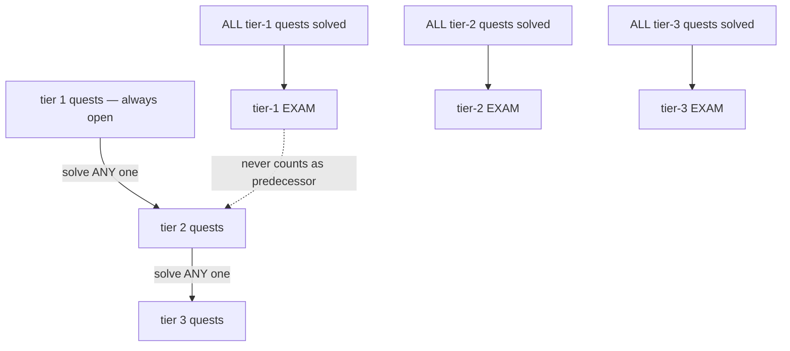
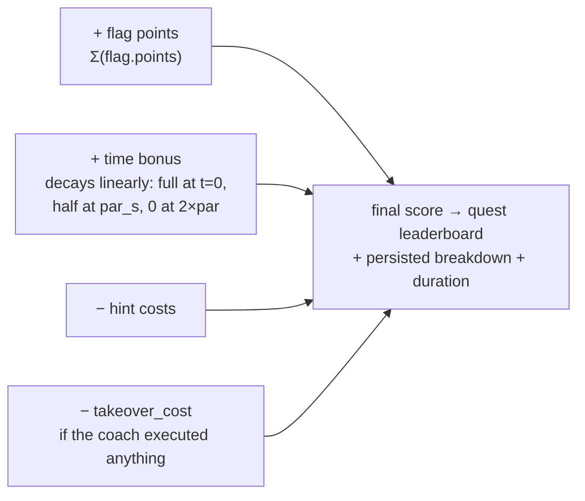

# Tracks & quests

**88 quests across 13 tracks**, organized in tiers 1–4. Teaching quests
generally include a briefing, coach checkpoints, staged hints and
`defense.md`; exams assess synthesis, while capstones go in blind.

## Progression rules

- **Tier N quest** unlocks when **any** non-exam quest of tier N−1 in the same
  track is solved.
- **Exam** (`meta.exam: true`, **EXAM** badge) unlocks when **every** teaching
  quest of its track+tier is solved — the capstone for that tier.
- Exams never count as tier predecessors — solving the T1 exam alone does not
  open T2.
- A **capacity gate** additionally locks quests the host can't fit right
  now: `resources.gate_mode = live` (default) weighs each topology's
  *ballooning floor* — not nominal RAM — against free host RAM, CPU
  overcommit, disk, and whether every referenced template exists on the
  node. `static` falls back to `resources.max_*` budgets; `off` unlocks
  everything. Locked quests always name the reason (missing template,
  prerequisite, or capacity).

## The tracks

### 🐧 Linux Fundamentals — `linux-fundamentals` (9)

Host services, misconfigurations, privilege escalation — guided basics to
multi-host chains.

| Quest | Tier | Focus |
|---|---|---|
| First Foothold | 1 | Weak SSH creds → sudo misconfiguration |
| Sticky Bits | 1 | SUID binary reads any file as root |
| **Exam: The Onboarding Box** | 1 | Loot → shell → one SUID climb, no walkthrough |
| Privilege Chains | 2 | Leaked creds, GTFOBins sudo, writable cron — pick a route |
| Wildcard | 2 | `tar *` in root's cron — filenames are arguments |
| **Exam: The Maintenance Window** | 2 | Two privesc paths, find at least one |
| The Pivot | 3 | Web host is the only path to the DB — pivot through |
| Permission Baseline | 3 | Read-only audit of service capabilities against an approved baseline |
| **Exam: Supply Chain** | 3 | Three hosts deep, creds leak at every hop |

### 🌐 Web AppSec — `web-appsec` (13)

OWASP vulnerability classes from basics to chained auth-bypass.

| Quest | Tier | Focus |
|---|---|---|
| Damn Vulnerable | 1 | DVWA: LFI + uploads |
| Trusting Query | 1 | SQLi login bypass → data extraction |
| Committed | 1 | `.git` deployed to prod, "removed" credentials |
| **Exam: The Leaky Portal** | 1 | Source disclosure → shell |
| Juice Heist | 2 | Juice Shop recon + ftp easter egg + admin section |
| Gallery | 2 | Upload blacklist + MIME trust → www-data → root |
| Pressing Matters | 2 | WordPress + wpscan → theme editor → flag |
| **Exam: The Intranet** | 2 | Login bypass + upload bypass + shell in one app |
| Broken Trust | 3 | SSRF into an internal API |
| Signed & Confused | 3 | JWT secret → IDOR → admin |
| **Exam: The Reporting API** | 3 | JWT + IDOR + API → root shell |
| Split-Second | 4 | 0.CL request smuggling: nginx front-end vs. Flask back-end desync |
| Template Trust | 3 | Static review of a customer-controlled server-side template boundary |

### 📡 Network & Recon — `network-recon` (8)

Discovery, enumeration, segmentation, pivoting across routed networks.

| Quest | Tier | Focus |
|---|---|---|
| The Perimeter | 1 | Five open services, creds follow from enumeration |
| Open Shares | 1 | Guest SMB share → runbook full of creds |
| **Exam: Neighborhood Watch** | 1 | Enumerate everything → leaked creds → root |
| Zone Out | 2 | AXFR giveaway, factory SNMP, anonymous TFTP |
| Behind the Firewall | 2 | Second host only trusts the first — pivot |
| **Exam: Perimeter Audit** | 2 | Edge box gossips; the target only listens to it |
| Three Hops Deep | 3 | DMZ → app tier → data tier, chained pivots |
| **Exam: Three Doors Down** | 3 | Every protocol from the tier pays off |

### 🏢 Active Directory — `active-directory` (7)

Domain attacks from a single DC to multi-forest corporate networks.

| Quest | Tier | Focus |
|---|---|---|
| Domain Join | 1 | One DC, one roastable service account |
| No Preauth | 1 | AS-REP roast without any credential |
| **Exam: First Contact** | 1 | Kerberoast + AS-REP + SYSVOL loot |
| Lateral Pressure | 2 | File server → workstation → DC, creds walk |
| **Exam: The Corp Lan** | 2 | Full corp chain + a surprise roastable |
| Enterprise | 3 | Flagship: 2 DCs, 2 workstations, nothing → Enterprise Admin |
| **Exam: Domain Takeover** | 3 | The complete kill chain, timed |

> [!WARNING]
> AD quests need **Windows templates** (`win2022-server-x64-template`,
> `win11-22h2-x64-template`) — built via `install.sh --with-templates` or a
> manual Ludus template build (hours, tens of GB). T3 wants ~48 GB RAM.
> Details: [ops.md — Windows / AD quests](ops.md#windows--active-directory-quests).

### 🔍 Forensics — `forensics` (7)

Log triage, disk artifacts, intrusion timelines on attacked ranges.

| Quest | Tier | Focus |
|---|---|---|
| The Break-In | 1 | Logs → intruder's stash → prove persistence |
| Wiretap | 1 | Replay credentials straight out of a NIDS capture |
| **Exam: Black Box** | 1 | One capture + one host → the trail |
| Post Mortem | 2 | SQLi in access.log → webshell → exfil archive |
| **Exam: Full Report** | 2 | The implant the attacker never mentioned |
| Correlated | 3 | Three-host intrusion: edge → app → DB exfil |
| **Exam: The Whole Incident** | 3 | Correlate web02 pop with the quiet db02 touch |

### 💻 Scripting & Automation — `scripting` (7)

Bash and Python glue code — the output artifact itself is often the flag
(`vm: kali` command flags verify files *you* produced).

| Quest | Tier | Focus |
|---|---|---|
| Recon.sh | 1 | First recon script → machine-readable report |
| **Exam: Report Generator** | 1 | One script, three data sources, one report |
| Nonce Grinder | 2 | Proof-of-work token API — brute-force the PIN |
| **Exam: Evidence Pipeline** | 2 | Pull capture → crack creds → land proof → flag |
| Blind Pipe | 3 | Command injection in a diagnostics CGI — scripted |
| Hands-Free Pivot | 3 | One script: upload bypass + cred theft + SSH pivot |
| **Exam: Zero-Touch Vault** | 3 | The whole kill chain, zero clicks |

### 📶 Wireless — `wifi` (6)

802.11 labs simulated **inside the target VM** with `mac80211_hwsim` — no
physical radios. You SSH from Kali into the lab VM (`wifi` user, creds in the
briefing); attack tooling lives on the VM itself.

| Quest | Tier | Focus |
|---|---|---|
| Captured Keys | 1 | Crack a packaged WPA handshake → AP admin |
| **Exam: Backup Channel** | 1 | Second capture + site survey mismatch |
| Live Air | 2 | Deauth a live client → handshake → crack PSK |
| **Exam: Ops Channel** | 2 | Live WPA2 + encrypted config backup |
| No Client Needed | 3 | PMKID leak + a rogue AP that shouldn't exist |
| **Exam: Dual Band** | 3 | Two networks: PMKID + full handshake cycle |

Packaged captures (`files/*.cap`) are real hwsim-generated handshakes —
regeneration: [ops.md — wireless labs](ops.md#wireless-hwsim-labs).

### 🏠 Home Lab — `home-lab` (1)

| Quest | Tier | Focus |
|---|---|---|
| Home Field Advantage | 1 | Point Kali at **your own LAN**: discovery → enumeration → read-only access checks → evidence → assessment report |

> [!CAUTION]
> This track attacks your real network over the Kali `net1` uplink. The coach
> enforces `lan.scope_cidr` (default: auto-detected /24 from the DHCP lease),
> read-only probes, and a shared action budget — but the ROE is on you:
> only devices you own, no DoS, no aggressive brute force.

### 🛡️ External Engagement — `engagement` (1)

Authorized real-target engagements use an operator-locked scope snapshot and
read-only validation. The coach denies actions outside the declared ROE.

| Quest | Tier | Focus |
|---|---|---|
| External Engagement | 1 | Operator-scoped reconnaissance, evidence validation and reporting |

### ☁️ Cloud-Native — `cloud-native` (9)

One live `kind`-cluster exercise plus lightweight, read-only RBAC and
GitOps release reviews.

| Quest | Tier | Focus |
|---|---|---|
| Soft-Schedule | 1 | Pod RCE → over-permissive service account → secrets → privileged pod → host flag |
| The Overbroad Role | 1 | Read-only review of Kubernetes RBAC against workload requirements |
| Release Gate | 1 | Read-only review of CI runner, production secrets and artifact provenance |
| Runtime Socket Exception | 1 | Static review of container runtime socket and host mount permissions |
| **Exam: Production Boundary** | 1 | Combined RBAC and release-provenance assessment |
| Metadata Boundary | 2 | Synthetic cloud metadata, outbound network and workload identity review |
| **Exam: Cloud Identity** | 2 | Combined workload permission and metadata exposure assessment |
| Reconciliation Authority | 3 | Read-only production GitOps permission and artifact provenance review |
| **Exam: Platform Assurance** | 3 | Correlated identity, metadata and reconciliation assessment |

### 🤖 AI Security — `ai-security` (8)

AI application security: a deterministic assistant exercise plus read-only
RAG and agent trust-boundary reviews (no external API key or GPU required).

| Quest | Tier | Focus |
|---|---|---|
| AskOps | 1 | Prompt injection: guard bypass → system-prompt leak → indirect injection via trusted docs → tool abuse |
| The Retrieval Boundary | 1 | Read-only RAG tenant-isolation and tool-authorization assessment |
| **Exam: Helio Support** | 1 | Combined review of AI data, identity, tool and audit boundaries |
| Protocol Ownership | 2 | Static review of tool registration, permissions and provenance |
| Model Provenance | 2 | Model artifact publisher, digest and validation-worker review |
| **Exam: Model Operations** | 2 | Combined AI tool governance and artifact provenance assessment |
| Agent Permission Boundaries | 3 | Multi-component identity, data authorization and audit review |
| **Exam: Responsible Agent Platform** | 3 | End-to-end assessment of AI retrieval, tools, artifacts and agent boundaries |

### 🐛 Exploit & Vulnerability Analysis — `exploits` (8)

Static, read-only review of vulnerability patterns and release controls. These
quests do not execute samples or provide working exploit payloads.

| Quest | Tier | Focus |
|---|---|---|
| Telemetry Under Review | 1 | Unsafe formatting boundary, compiler hardening and artifact evidence |
| Shared Runner | 1 | CI contribution trust, runner isolation, secret scope and artifact handoff |
| Data, Not Objects | 1 | Static review of unsafe artifact loading and data-only schema controls |
| **Exam: Release Readiness** | 1 | Prioritized source, pipeline and package assessment |
| Build Assurance | 2 | Source, compiler policy and release artifact provenance review |
| **Exam: Build Integrity** | 2 | Correlated source/build and CI runner assurance assessment |
| Patch Decision | 3 | Synthetic advisory triage, containment and vendor-fix verification |
| **Exam: Appliance Assurance** | 3 | Full read-only appliance release and vulnerability response assessment |

### 👑 Capstone — `capstone` (4)

| Quest | Tier | Focus |
|---|---|---|
| Nordmarkt Feinkost | 2 | Single-box engagement: web enum → backup leak → foothold → internal API cmd-injection → DB LOAD_FILE → cron privesc → written report |
| Nordwind Logistics | 3 | Full engagement: recon → source leak → foothold → two pivots → API compromise → DB creds → hash crack → privesc → written report |
| Cloudburst | 4 | Cloud-native kill chain: edge SSRF → k8s API abuse → privileged escape → node loot — end to end |
| NeuralSwarm | 4 | Blind, read-only assessment correlating AI retrieval, cloud delivery and release evidence |

> [!NOTE]
> Capstone quests ship **no hints, no checkpoints, no cheatsheet and no
> coach briefing** — the engagement letter is all you get. They double as
> the full-auto agent benchmark: see [agent-eval.md](agent-eval.md).

## Scoring

- **Flag points** — every flag carries `points`; their sum is the score's
  base. (`scoring.base` in quest.yaml is a display reference, not added.)
- **Time bonus** — `time_bonus_max` scaled by `1 − t/(2·par_s)`: full
  only on an instant clear, half at par, zero at 2×par.
- **Hint costs** — shown up front per hint (−25, −50, …).
- **Takeover cost** — a flat `takeover_cost` once the coach executes at
  least one command (autonomy 4), not per action.
- **Breakdown** — every attempt persists its components (`flags`,
  `time_bonus`, `hint_cost`, `takeover_penalty`, `par_s`); hover a score
  on any leaderboard to see them, and the global board shows the best
  run's duration.
- **Solve style** — the leaderboard shows per-attempt aid chips:
  `sheet`, `panel`, `coach`, `tips`, `hint`, `takeover`. Solving with no
  assistance earns the `solo` badge.

Per-quest and global leaderboards: **Leaderboard** page and
`GET /api/quests/{id}/leaderboard`.
