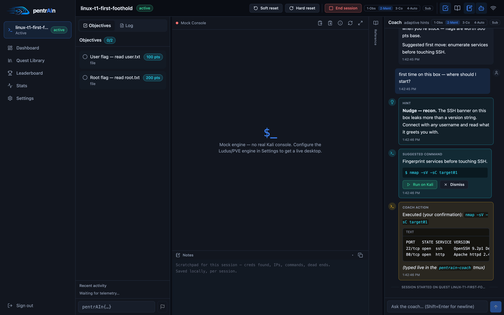
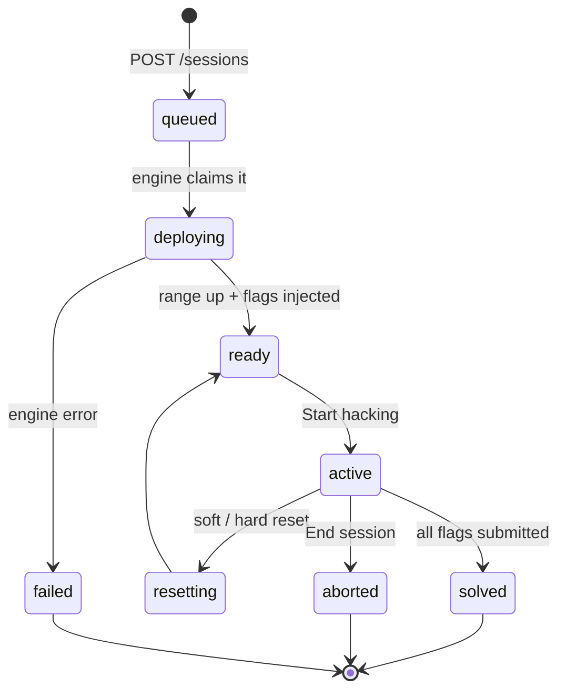
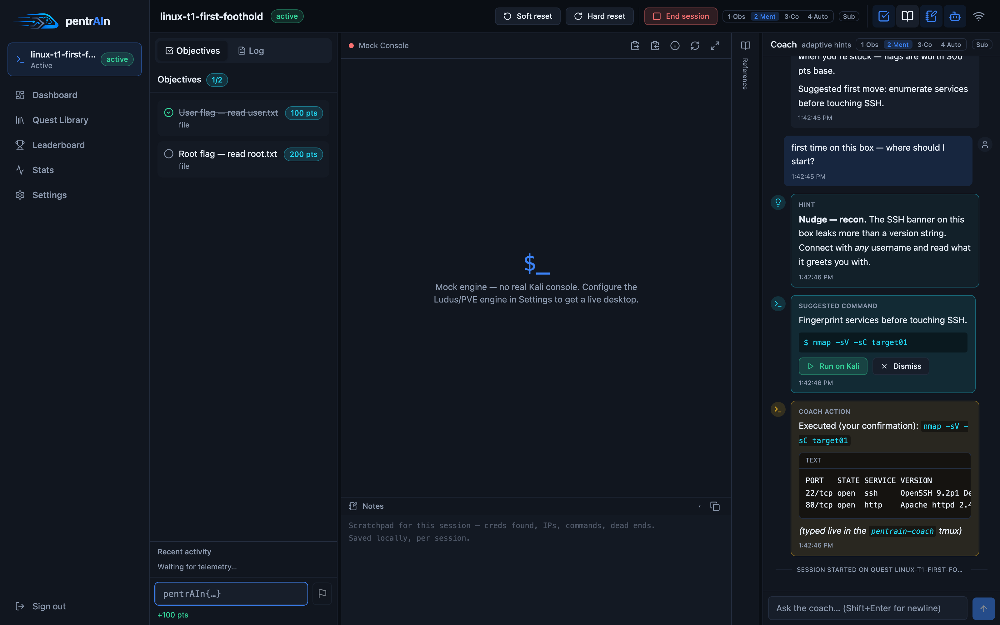
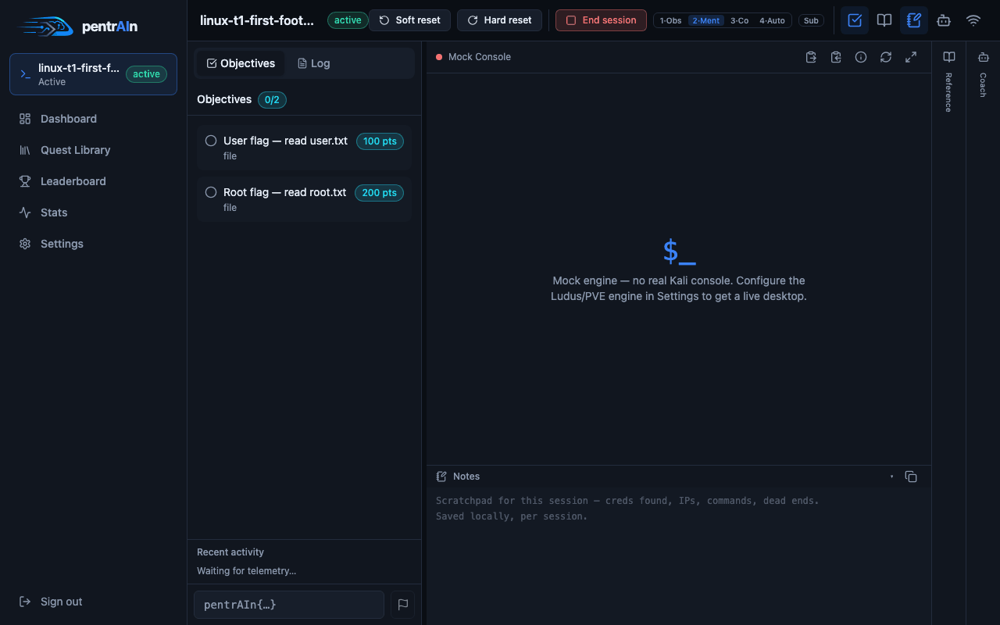
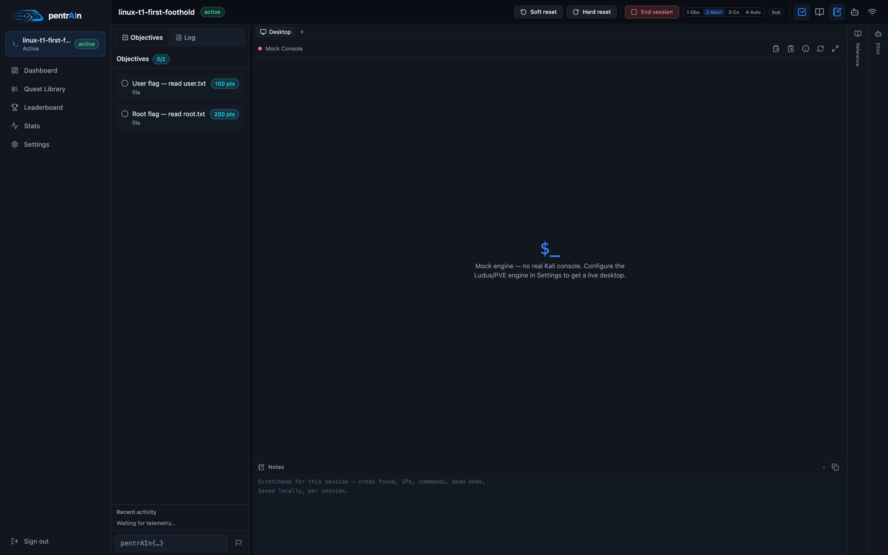
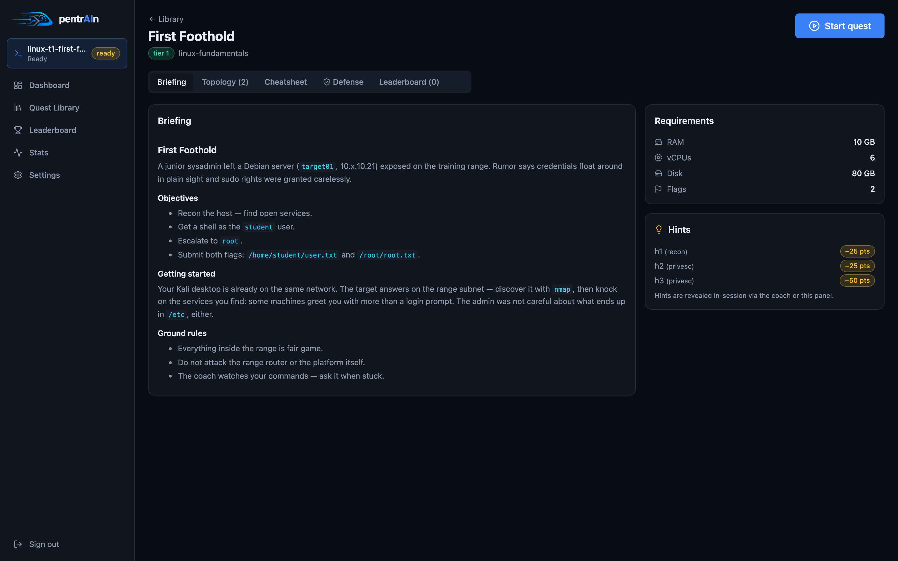

# The workspace

The session page is where you spend 99% of your time: a real Kali desktop
streamed into the browser, objectives and flags on the left, the AI coach on
the right.

> [!NOTE]
> The screenshots in this page were captured against the **MockProvider** —
> the console area shows a placeholder where a real deployment streams a live
> Kali desktop over noVNC.

## Lifecycle at a glance

| State | Meaning |
|---|---|
| `queued` / `deploying` | Range is being built — watch the **Log** tab |
| `ready` | Range up, flags injected, console ticket available — press **Start hacking** |
| `active` | Working session: telemetry flows, coach watches, timer runs |
| `resetting` | Soft or hard reset in flight → lands back on `ready` |
| `solved` | Every flag submitted — leaderboard entry written |
| `aborted` / `failed` | Terminal — range is destroyed |

## Header toolbar

Left → right, top of the session view:

| Control | What it does |
|---|---|
| **quest title + state badge** | Live state, plus deploy elapsed time while deploying |
| **Start hacking** | Activates a `ready` session (mounts the console, starts the clock) |
| **Soft reset** | Snapshot rollback of all range VMs — fast, flags re-randomize |
| **Hard reset** | Destroy + redeploy — new VMIDs, new networks, new flags |
| **End session** | Tear down the range entirely |
| **1-Obs · 2-Ment · 3-Co · 4-Auto** | Coach autonomy, same as `/autonomy <n>` in chat — see [coach.md](coach.md) |
| **Sub** | Toggle L4 subagent workers on/off for this session |
| **📶 Kali internet** | Hot-plugs a second NIC (`net1`) onto the WAN bridge — see below |
| **panel icons** | Toggle Progress / Reference sheet / Notes / Coach panels |

## The console

Real mode proxies the Proxmox noVNC console of your session's Kali VM — full
desktop, full keyboard/mouse.

| Toolbar button | What it does |
|---|---|
| **Paste as keystrokes** | Types arbitrary text into the guest — the reliable way to get passwords and URLs in |
| **Read guest clipboard** | Fetches the VM's clipboard via the guest agent |
| **Kali login** | Shows the session's Kali credentials |
| **Reconnect** | Forces a fresh console ticket |
| **Fullscreen** | Immersive mode |

The console auto-reconnects when the ticket drops (e.g. after a soft reset —
the new `ready_at` remounts the view).

## Left panel — Progress

Two tabs:

- **Objectives** — every flag with its points value, ticking live as you
  solve. Below it: **Recent activity** (telemetry feed), **Notes** scratchpad,
  and the **flag input**.
- **Log** — the full deploy log (Ludus range build, ansible roles, flag
  injection). First place to look when a deploy misbehaves.

## The flag box

Flags are `pentrAIn{...}` secrets, **randomized per session** (HMAC-derived,
injected post-deploy via the QEMU guest agent). Type or paste the value into
the `pentrAIn{…}` box at the bottom of the Progress panel:

- Correct → the objective ticks, points land, a coach ack fires.
- Last flag → session flips to `solved`, score is written to the leaderboard.

> [!TIP]
> Flag *files* are never planted by the ansible roles — the backend writes
> them after deploy. Soft-resetting regenerates every secret, so an old flag
> from a previous attempt will not validate.

## Right panels

| Panel | Contents |
|---|---|
| **Reference sheet** | Live **network map** (VM names → range IPs), host inventory, flag counter, quest + track cheatsheets — spoiler-free reference material |
| **Notes** | Per-session scratchpad (localStorage) — creds, IPs, dead ends; copy button included |
| **Coach** | The full chat: messages, hints, command suggestions, action reports — see [coach.md](coach.md) |

Panels are **resizable** (drag the edge, double-click to reset) and
collapsible to edge strips; layout persists in `localStorage`.

### The "Assistance ahead" prompt

Opening the **sheet** or **coach** panel the first time pops a warning —
using help is a choice that changes what the session teaches you, and it is
recorded (`POST /sessions/{id}/assist`) as part of your leaderboard *solve
style* (`solo`, `sheet`, `panel`, `coach`, `tips`, `hint`, `takeover`).

## Live stats overlay

A compact chip row over the console: Kali CPU/mem/net from session metrics,
plus host CPU and temperature (when `engine.hoststats_url` or the derived
`:9100` agent answers).

## Kali internet toggle

Clicking the 📶 button hot-plugs a **second NIC (`net1`)** onto the WAN bridge
(`engine.kali_wan_bridge`, default `vmbr0`):

- Kali gets a LAN address via DHCP — real internet for tooling, `apt`,
  wordlists, home-lab assessment.
- **Targets stay isolated** — only the Kali VM gets the uplink; the range's
  default route is removed while the uplink is up and restored on removal.
- Internal target names keep resolving: managed `/etc/hosts` entries map
  `target01`, `pentrain-api01` etc. to range IPs (split-DNS without the
  conflicting resolvers).
- `kali.internet_default` in Settings attaches the uplink to every *new*
  session.

> [!WARNING]
> The uplink bridges Kali into your real LAN. Only enable it on networks you
> own, and remember: the home-lab track explicitly scopes what the coach may
> touch (`lan.scope_cidr`).

## Hints

Each quest ships staged hints (`h1`, `h2`, …) with a **points cost** shown up
front — visible on the quest detail page before you ever deploy:

Reveal them in-session (Objectives panel or coach offer); the cost is deducted
from your score. See [tracks.md](tracks.md#scoring) for the full scoring model.

## Resets, in detail

| | Soft reset | Hard reset |
|---|---|---|
| Mechanism | Snapshot rollback on all range VMs | Destroy + full redeploy |
| Speed | Seconds–a minute | Full `est_deploy_min` again |
| Flags | **Re-randomized** — old secrets die | Re-randomized |
| VMIDs / networks | Unchanged | Fresh range, new VMIDs |
| Use when | You broke a target | Range is wedged / you want a clean slate |

Both confirm first; the deploy **Log** tab shows progress.
